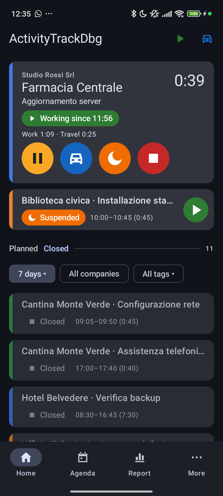
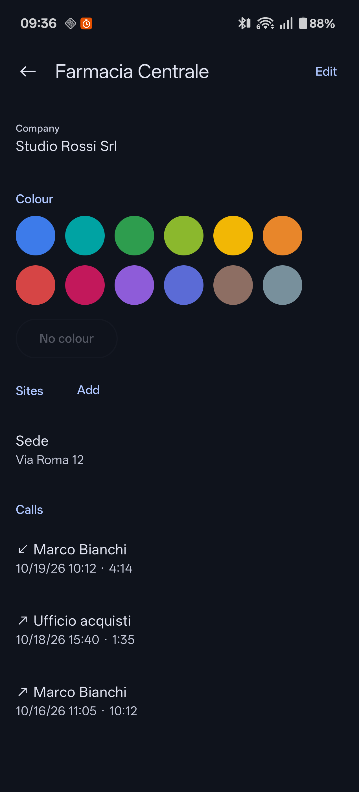
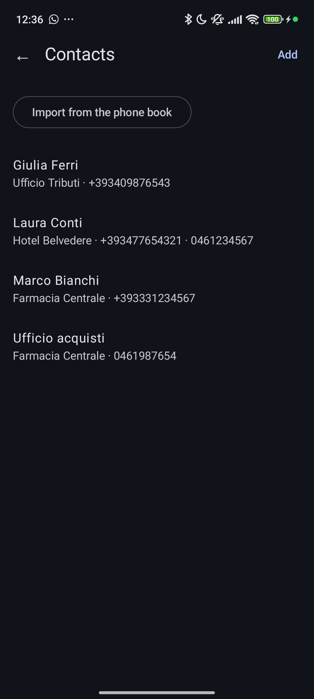
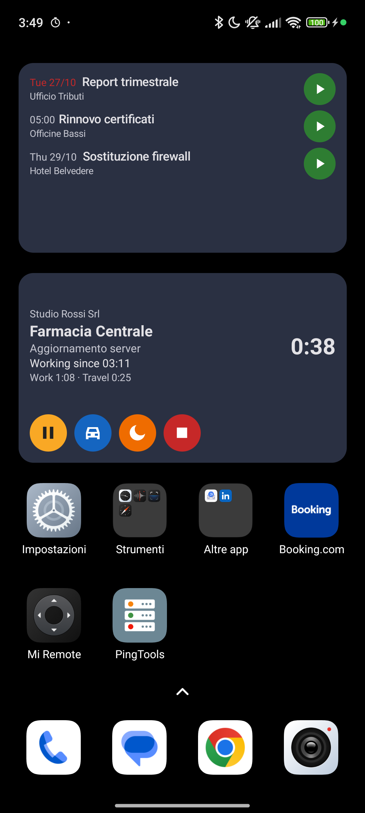

Version 0.7.6 (October 2026). Please report any difference between this
manual and the app. The *Quick start* sums up daily use in a few pages; this
manual covers everything: **Part I** how to use the app, **Part II** the
reference (settings, entities, states, flows).

**New in 0.7.8** (not yet tested on the phone)
- Done to-dos show **"done"** and when they were done, no longer
  "planned" with the planned time; in "Done" they are sorted by that
  moment and dimmed like the closed activities.
- Tapping a to-do, **State**: "Open", "Done" or "Ignored", whatever it was
  before; **"Remove the plan"** removes its date and time (§8).
- Clearer names: the state "To complete" is now **"Details missing"**, the
  Home tab "Closed" is now **"Done"**.
- The big card's buttons carry their **name under the icon**; the first
  **Suspend** explains once how it differs from Pause (§5).
- **New activity**: two selectors, **Work / Travel** and **Now / Already
  started / Past**; the green button says what happens ("Start now",
  "Start from 09:15", "Record 09:15–10:40") (§4).
- **Stop**: one closing sheet with the end, the return travel, the missing
  description and the to-do done, instead of questions in a row (§6).
- **Activity screen**: a summary on top (state, total, bar of the segments),
  expenses and attachments further down, Delete in the ⋮ menu, Save
  prominent (§6).
- **To-dos** is a tab of the bottom bar; the Home "To-dos" tab ends with
  "All to-dos →" (§3).
- **Undo** for a few seconds after "done", "ignore", "postpone", "remove the
  plan" or a change of state of a to-do (§8).
- **First start**: with no client the Home shows **"Getting started"** (§2).
- The Report and the evening summary show one **total** (the reported
  time); Settings list the essential sections first, the others under
  **"Other settings"** (§14).

**New in 0.7.6** (tested on the debug phone)
- One name for the to-dos: the Home tab and the widget are called
  **To-dos**.
- Settings: a dot in the title flags unsaved changes and leaving asks first
  (§14).
- To-do editor: a live warning when the plan passes the due date, with
  "Align the due date" (§8).
- **Quick stop** in the Stop question (§5); **gesture tips** at first use
  (§3, "Gestures").
- The to-dos widget suspends the running activities when it starts one.
- Fixes: the widgets update at once (a done to-do no longer stays on the
  to-dos widget, the running activity's time moves on); at night, before 06:00, "Closed · Today" shows the working day
  begun yesterday at 06:00, as the reports do.

**New in 0.7.2** (tested on the debug phone)
- **Times** coloured by kind: work green, pause yellow, travel blue; the
  **running** segment can change its date and start (§6).
- **Integrations**: an activity deleted after sending is deleted in the
  management system too at the next sync; Antares asks for the client's
  **Premises** for activities on a service (without it they were refused).
- A guide to writing a plugin (`plugins/GUIDE.en.md` in the repository).

**New in 0.7.1** (planning not tested on the phone)
- To-do **planning**: date only, date and start (a moment), or date and
  range; at the end of the working hours a notice proposes to re-plan those
  not worked on (§8).
- **Colour** also when adding a company or a client from the screens (the
  "+").

**New in 0.7.0**
- **Antares (Saidea)**: the first management system connected as a plugin,
  tested on the demo (login, services, clients, tickets as to-dos, activities
  sent and updated). Separate guide: *Antares integration*.
- Tickets arrive where you are the technician or the applicant; their HTML
  descriptions become plain text.
- Dialogs: the first field's label is no longer cut; drop-down menus stay
  above the keyboard.

**New in 0.6.8.1**
- Manual: every screenshot updated to the current app.

**New in 0.6.8** (tested on the debug phone)
- The **policy** acts on the screens: fields hidden, renamed, coloured or
  required, features switched off, settings locked with a padlock, use
  **without companies** (§11, "Policy and integrations").
- The management system's fields show in the activity screen (in 0.6.7
  they stayed invisible).

**New in 0.6.7** (version not tested on the phone)
- **Policy** (`policy.json`) and **integrations as plugins** (`plugins`
  folder): §11, "Policy and integrations". First release, to be tried.

**New in 0.6.4** (version not tested on the phone)
- **Agenda**: reopens on the last view; in Day and Week the working hours fill
  the screen and **two fingers** change the scale (§7).
- **Time grid** centred on the working hours (§3).
- To-dos: **"Edit"** instead of "Re-plan" (§8).
- **Colour dot** in the company, client and contact lists (§10).
- **"Back up now"** in Import / export, beside the restore (§11).
- Manual PDF: screenshots no longer fill a whole page.

**In 0.6.3**: overlapping segments resolved on confirm, deleting an activity
and hand-made to-dos, menu icons.

Names in quotes are the labels of the English interface; the app also speaks
Italian, German and Spanish.

---

# Part I — Using the app

## 1. Concepts

**Activity** — a piece of work for a client (or for a company, when
travelling without a known client). It has client, company, role,
description, locality, notes, external references (tickets, URLs, codes),
tags, expenses and attachments.

**Segments** — the time of an activity is made of segments:
- **Work** (green), **Travel** (blue), **Pause** (yellow).
- They are recorded to the minute; rounding and day attribution apply only to
  reports and exports.

**States of an activity**

| State | Meaning |
|---|---|
| Running (work / travel / pause) | time is running |
| Suspended (orange) | interrupted, to be resumed later |
| Details missing (red) | stopped, client or description missing |
| Closed | completed |

Several activities can run at the same time (e.g. a travel and a work call
for another client).

**Total** — the time of the Report and of the evening summary: the sum of
rounded work and travel of all activities, by the rules below.

**Report rules** (Settings → "Reports")
- Work: rounded up to the quarter hour with a 5-minute tolerance (e.g.
  1 h 04 → 1 h; 1 h 05 → 1 h 15); short work counts at least 15 min.
- Travel: rounded up to 5 minutes.
- Pause: rounded down to 5 minutes, at least 5.
- Night: an activity ending by 06:00 the next day stays on its start day;
  later than that, it is split at midnight.

---

## 2. First start

**Installation** — the app in use comes from the repository's GitHub
*Releases* (file `ActivityTrack-<version>.apk`); new versions install over the
old one and keep the data. The phone may also hold **ActivityTrackDbg**, the
test build installed from the PC: a separate app with its own data and folder
(`ActivityTrackDbg`).

1. **Data folder** — the app asks for a folder (`ActivityTrack`) for
   attachments, backups and exports. The files stay even if the app is
   uninstalled. If the folder is moved or renamed the app says so ("Access to
   the data folder was lost") and asks for it again.
2. **Permissions** — notifications and location are asked on first start. In
   Settings → "Location":
   - "Location access" → **"Allow all the time"**: tracking can then restart
     after a reboot or from a notification;
   - "Battery optimisation" → **"Allow"**: on OxygenOS this keeps the system
     from stopping tracking.
3. **Minimum master data**: with no client the Home shows **"Getting
   started"** with **"Create the first client"** (name, company with its "+",
   colour) and **"Import from a file or a management system"**; or "More" →
   "Master data": at least one company and one client. Also useful: "Working hours and lunch break" (for the day-start
   prompt and the evening summary) and a site for frequent clients (the client
   is then proposed automatically).

---

## 3. The bottom bar

| Tab | Content |
|---|---|
| **Home** | the running activity's card (or ▶ Start / 🚗 Travel), small cards of the others; below, the **To-dos** and **Done** tabs |
| **To-dos** | all the to-dos, with filters (§8) |
| **Agenda** | consultation: list, day, week, month |
| **Report** | one day's report: total, one line per activity, export |
| **More** | "Import / export", "Master data", "Settings" (with "Gestures") |

From a tab other than Home, Back returns to Home.

### Home cards
- At the top the **big card**: the most recent open activity, with time,
  state and commands (each button with its name underneath). With no open activity it shows "No activity running"
  with **▶ Start** (opens "New activity") and **🚗 Travel** (the travel starts
  at once; the destination is set later or comes with the arrival); dragging
  it left starts, dragging it right starts the travel.
- With open activities, ▶ and 🚗 sit in the top bar (🚗 opens "New activity"
  with Travel selected, because it asks what to do with the others).
- Below, a **small card** for every other open activity (paused, suspended,
  with details missing): state and times as "from–to (length)" (e.g.
  "11:00–11:45 (0:45)"), and a button to resume it (or pause it, or complete
  it). Tapping it brings the activity to the big card.
- At the bottom the two **tabs** (0.7.4; browser-like tabs since 0.7.5):
  **To-dos** and **Done** ("Closed" up to 0.7.7). Switch
  by tapping the tab or dragging the header horizontally (the card
  gestures stay); the chosen tab is remembered across restarts.
- **To-dos**: those planned or due within the chosen period, the
  overdue ones first (their time in red); under a **"No date"** separator
  those without a plan and without a due date; at the bottom, struck
  through, those ignored today. The period next to the title: **24 h**
  (default), **3 d**, **7 d**, **30 d** or **All** — separate from the
  "To-dos" tab's. Next to it, **"All companies"** filters the to-dos by
  company. At the end **"All to-dos →"** opens the "To-dos" tab of the
  bottom bar.
- **Done**: activities closed or with details missing and to-dos marked done
  ("done" and when you marked it), the most recent end first; the tag filter lives here (to-dos carry no tags).
  The period: **Today** (default, from the 06:00 carry-over boundary as in
  the reports), **24 h**, **7 d**, **30 d**.

### Gestures (dragging the cards)
Every card can be dragged left or right (Home, Agenda list, "To-dos"
screen). A short drag reveals the buttons to tap; a long drag runs the first
one at once.

| Card | Left | Right |
|---|---|---|
| Running activity | Pause, or Resume if paused or suspended | Stop (with the same questions as the Stop button) or Suspend |
| To-do | Start | Postpone (if planned) or Ignore |
| Ignored to-do | Restore | Restore |

They are changed in "Settings" → **"Gestures"**: what each direction offers
(also nothing), and whether a long drag runs the first action. At first the
Home shows a **tip** about the gestures ("Got it" closes it) and the cards
carry a faint ‹ › on their sides until one is dragged; "Gestures" → **"Show
the gesture hints again"** brings both back (0.7.6), with the explanation
of the first Suspend (§5).

### Company and client colours
In a company or client screen ("More" → "Master data") pick a **colour** out
of twelve, or "No colour". Activity and to-do cards have a thin **vertical
band** on the left with the company colour; when a list shows a single
company, the band has the **client** colour. Without a chosen colour there is
no band; in the Agenda the blocks of those companies are grey.

Next to the planned-to-dos period (and in the "To-dos" tab) the **"All
companies"** button filters to-dos by company: the filter stays until you
remove it with ✕. Running activities are not filtered. In the "To-dos" tab
the period filter (**24 h**, **3 d**, **7 d**, **30 d**, **All**, the same as
on Home) shows the
to-dos planned or due within that time (overdue ones always),
**"Ignored"** shows or hides ignored to-dos. **"Filters"** opens the
advanced filters: client, priority, state (open, planned, overdue), planned
yes/no; "Clear" removes them.

### Compact display
Settings → "Display" → **Compact**: slightly smaller text, tighter cards and
buttons, to see more activities and to-dos at once.

### New company or client on the fly
The **+** next to a master-data field creates the new item without leaving,
already selected (a quick pick fills the description): Company, Client,
Quick pick and Role in "New activity" and in the activity screen; Company and
Client in the to-do editor; the client of a contact (also one imported from
the phone book); the company of a client and of a quick pick, with its
proposed role.

### Required and optional fields
The border colour tells how much a field matters:

| Border | Meaning | Examples |
|---|---|---|
| **red** | required, still empty | client, description, to-do title |
| **green** | required, filled | the same once filled; expense amount and description |
| **yellow** | important, not required | role, planned date and time, start and end |
| **blue** | accessory | notes, references, locality, duration, due date, priority |

The field you are typing in has a thicker border in the theme colour: do
not mistake it for the accessory blue. Drop-down menus show the
colour of companies and clients. In "New activity" the company only filters
the clients: with "All companies" the border is neutral, and it turns green
once a company is picked or comes from the client.

### Dates and times
Dates are picked on the Android calendar. Times on a **5-minute grid**: one
row per hour, 12 cells per row, 12 hours at a time (**▲ Earlier** /
**Later ▼** move the window by 3 hours). With no time chosen yet the window
opens centred on that day's working hours.
- single time: tap a cell; **"Exact time"** opens the Android clock for
  minutes off the grid (e.g. 09:37); OK without a tap keeps the time as it
  was;
- segments (Edit segment, + Travel, + Pause): tapping Start or End, the grid
  picks both: touch the first cell and drag to the last, or tap the first and
  then the last (also after moving the window). The header shows the range
  and its length; **hatched** cells are taken by other segments of that day.

Optional fields have an ✕ to empty them.

### Emptying a field
Text fields (description, notes, names, tags, references, agenda search…)
show an **✕** as soon as they hold text: tap it and the field is emptied. In
the client search boxes the ✕ empties the search and lists everything again;
the chosen client stays until you pick another.

---

## 4. Starting an activity

On Home: **▶ Start** in the "No activity running" card (or drag it left), or
**▶** in the top bar when other activities are open.

In the "New activity" screen (0.7.8):
- two selectors at the top: **Work / Travel** (a travel may start without a
  client) and, with "Times freely editable" (on by default), **Now / Already
  started / Past**, which decides the times asked;
- **Company** filters the clients; **Client** is a box where you type to
  search (case and accents are ignored) or pick from the list, in the order
  chosen in Master data (by default the most recent first).
- Within the radius of a site, client and company are already proposed;
  otherwise the app proposes the company of today's last activity.
- then **Quick pick** and **Description**, then the **role**: description and
  role are proposed from the last activity on the same client in the last 30
  days. The microphone in the field dictates.
- **Now**: no times, the activity starts at once.
- **Already started**: only **"Started at"**, with the shortcuts **15 / 30 /
  60 min ago**; the activity stays open until Stop. A time still to come
  today asks **"Start at HH:MM"**: **"Plan it today at HH:MM"** creates a
  planned to-do (client, title = description), **"Start now"** starts at
  once, **"Started yesterday at HH:MM"** records it from yesterday.
- **Past**: **Date** (empty = today) and **Start / End** on one row; tapping
  them, the grid picks start and end together. The activity is recorded
  already stopped at that time, with no further question, also about the
  running activities. A future date offers to plan it as a to-do.
- The green button at the bottom (blue with the car for a travel) says what
  happens: **"Start now"**, **"Start from HH:MM"** or **"Record
  HH:MM–HH:MM"**.

**If another activity is running**, the app asks what to do with it:
- working: close, suspend or leave it running;
- travelling: "is the travel over?" (yes = stop, no = leave, or suspend);
- paused: close or leave it.

**Other ways to start**
- from the day-start notification ("Start activity");
- from a **to-do** (client, description and references already filled);
- from the 4×1 **widget** or the icon **shortcuts** (recent clients): the
  start screen opens with the client selected;
- from a recognised **call**: the screen opens as **Past** with the call's
  times.

---

## 5. While working

### Commands
On the Home card and in the notification:

| Icon | Command |
|---|---|
| ▶ green | Work / Resume |
| ⏸ yellow | Pause |
| 🚗 blue | Travel |
| 🌙 orange | Suspend |
| ⏹ red | Stop |

The card shows the time of the current segment in large type and the state
in a coloured label; each button has its name underneath. **Pause** is a
break inside the activity, counted as a pause; **Suspend** leaves the
activity to resume it later (e.g. to work on another one), and the time in
between does not count. The first Suspend explains this once, before running.

**"Stop"** opens the closing sheet (§6). Stop from the notification, the
widget or the quick tile always stops at once.

### Ongoing notification
One notification per running activity, with a chronometer and commands.
While location is active it cannot be swiped away; otherwise it comes back
when you reopen the app.

### Reminders
- **Confirm** every 30 minutes of work or travel: "Still on …?" with "Yes",
  "Pause" or "Stop at hh:mm" (stops at the last confirmation, if you forgot).
  Without an answer the activity goes on.
- **Pause** every 15 minutes ("Still on pause?"), muted during the lunch
  break.
- **Summary** at the end of working hours: the day's total.

### Location (automatic)
- One point every 5 minutes, plus one when the phone moves; never exported.
- **"Away from …?"** — while working, beyond 100 m: "Travel since hh:mm"
  (the travel starts when you left), "Ignore", "Stop at hh:mm".
- **"Arrived?"** — while travelling, after 15 minutes standing within 100 m:
  at a client's site it proposes "Work for … since hh:mm" (it assigns that
  client to the travel if it had none); at home it proposes to stop;
  otherwise "Work since hh:mm" or "Still travelling".
- Travel km are road distances (OSRM) and the locality comes from the address
  service (Nominatim), when the network is available.

Tap the notification **buttons**, not the text: the text opens the app and
closes the notification without running the action. If the buttons are not
visible, drag the notification down to expand it.

At the top of the activity screen, below the state, a row of buttons adds an
**Expense**, a **Photo**, a **Voice** note, a **File** and a **Material**; the
"Expenses", "Materials" and "Attachments" sections further down list them
(they appear once there is one).

### Expenses
In the activity screen, the **Expense** button: amount in euro,
description, optional "Receipt photo". Quick expense: the **€** button of the
widget or the **"Expense"** icon shortcut (goes to the most recent running
activity).

### Consumables
The **Material** button: the consumables left at the client. **Description**
required; **quantity**, **unit of measure** and **unit cost** optional.
Picking one from Master data → **Consumables** copies description, unit and
cost, still editable (a later price change leaves the recorded lines as
they are). The "Materials" section shows the total; tap a line to edit or
delete it.

### Attachments
Buttons **Photo** (camera), **Voice** (records until "Stop and save"),
**File** (any document). Tapping an attachment: "Open" or "Delete".
Files live in the data folder, under `attachments/<year>/<activity>/`.

### Calls with clients
With recognition on (Settings → **Calls**, incoming and outgoing
separately), at the end of every call with a number listed in Master data →
**Contacts** the app reads the call log and:
- records the call (shown in the client screen, **"Calls"** section, with its
  length);
- while you are working for **the same client**, does nothing else: the call
  is part of the activity;
- while you are working for **another client**, **pauses** that activity for
  the length of the call, with the description "Phone call CLIENT", and
  resumes it at the end ("Pause …" option); a call under a minute makes no
  pause;
- except for the same client, proposes with a notification to **record the
  call as an activity** ("Propose …" option): "Create activity" opens "New
  activity" with the client, the description "Phone call with NAME" and the
  times rounded to 5 minutes (start down, end up).

It works only within working hours (not on holidays and days off), unless
**"Also outside working hours (on call)"** is on: then it always works.
Calls with unknown numbers are ignored.

---

## 6. Stopping and completing

**Stop** from the app (button or drag) opens one **closing sheet** (0.7.8):
- **End of work / Start return travel** (the return travel belongs to the
  same activity; not shown when already travelling);
- **End**, with "Times freely editable": empty = now, otherwise the activity
  stops (or the return travel starts) at that time; it cannot be in the
  future nor before the start of the current segment;
- the **description**, when missing, with **"Copy the last: …"** (the last
  one on the same client); without a description the activity stays
  **"details missing"**;
- **"To-do done"**, when the activity started from a to-do (ticked at
  first): untick it if you will come back to it;
- when the activity lasted **less than a minute** (without attachments or
  expenses), a warning with **"Discard"**: it was probably started by
  mistake;
- **"Close"** stops the activity; **"Quick stop"** stops at once ignoring the
  rest of the sheet; **"Cancel"** leaves everything as it was.

A travel with nothing to ask (times not editable, description present, no
to-do) stops at once, without the sheet.

After Stop, when client and description are there the activity is
**closed**; otherwise it has **details missing** (persistent notification
and red card).

In the activity screen (0.7.8):
- at the top the **summary**: state, total of work and travel, a **coloured
  bar** of the segments in their order (tap it, or "Times ›", to go to the
  segments), the work, travel and pause totals and the **+ Travel** and
  **+ Pause** buttons (forgotten segments, also with km; at least one
  minute);
- then client, quick pick, description (can be dictated), contact, role;
  locality, place and notes stay folded under **"More details ▾"** while
  empty. The **Contact** field (optional, when the client has contacts) ties
  the activity to the person you worked for;
- "Times": every segment has the coloured icon of its kind (work green,
  pause yellow, travel blue). With "Times freely editable" on, tapping a closed segment opens
  **"Edit segment"**: date, start, end and, for travels, km; **"Delete"**
  removes it (not the running one nor the only one left). The running
  segment changes its date and start only (e.g. a restart recorded late);
  its end is recorded with the next command. The new values
  replace the recorded ones. When the segment (also one added with Travel or
  Pause) overlaps other segments of the same activity, the app shows them
  and asks to confirm: then the saved segment wins and the others are
  shortened, split or removed where it covers them. Segments of other
  activities are not checked: they stay concurrent activities;
- **"Delete"** in the **⋮** menu at the top deletes the **whole activity** with segments,
  expenses, references and tags. With attachments, delete them by hand
  first from the "Attachments" section. An activity started from a
  management-system **ticket** loses only the recorded time: the to-do goes
  back to the open ones (you may ignore it afterwards);
- **pauses** have an optional **description** (e.g. "Phone call CLIENT" for
  those made by a call; empty for manual ones): tap a pause to edit or clear
  it, also with "Times freely editable" off;
- **Tags**: free labels (e.g. `#remote`, `#urgent`); type one or more and tap
  "+", or tap a suggestion among those already used; the ✕ on a tag removes
  it. They can be added after closing too;
- **Expenses and attachments**: one row of coloured buttons (**Expense**,
  **Photo**, **Voice note**, **File**, **Material**) above their sections;
- "External references": tickets, URLs or codes (recognised automatically);
- at the bottom the main button fills the row: **"Complete"** (green) when
  details are missing, otherwise **"Save"**.

Completing without a description the app asks: **"Leave empty"**, **"Copy
the last: …"** or **"Back to editing"**; for an activity started from a
to-do still open it asks **"Is the to-do done?"** ("Yes" marks it done, "No,
I'll come back" leaves it open).

"Reopen" brings a closed activity, or one with details missing, back to
suspended.

---

## 7. Consulting: Agenda and Report

### Agenda
At the top the modes and the period ("‹ ›" to scroll, "Today" to come back;
on the right the period's reported total).
- **List** — the month, day by day, with a search on client, description or
  tag (`remote` or `#remote`); tags follow the description; planned or due
  to-dos show with ☐.
- **Day** — a timeline: every activity is a block from start to end;
  concurrent activities side by side; planned to-dos are blocks with a
  coloured border.
- **Week** — seven columns from Monday; tapping a day opens the Day view.
- In Day and Week the timeline covers the whole day and opens with all the
  working hours on the screen (or on the running activity, when outside
  them); **two fingers** (pinch) zoom the scale in or out.
- The Agenda reopens on the last view picked.
- **Month** — a grid with reported hours per day, one dot per company and one
  for to-dos; tapping a day opens the Day view.

**Tag filter**: the "All tags ▾" chip next to the modes (shown when the
period has tagged activities) shows only the activities with that tag;
to-dos are hidden and totals count only what is shown.

Every company has its colour. Tapping an activity opens it; tapping a to-do
opens its actions (start, postpone, done, re-plan).

**Planning from the agenda**: in Day and Week tap a free slot: a new to-do
planned at that time opens (half-hour steps). "Add" at the top does the same
for the day shown (today: the next half hour; other days: 09:00).

### Report

One day's report: the **total** (rounded work and travel), one line per
activity with exact → rounded work, travel and pause; export starts from here
too. With the tag filter only the activities with that tag remain and the
total is their sum. Export has a **Tag** field
too (only the activities with that tag; the other interchange sections are
not filtered).

---

## 8. To-dos

To-dos, imported from a management system or created by hand (the
**"To-dos"** tab of the bottom bar → "Add", or from the Agenda): title, client (or company), **planned
date** with an optional **time**, due date and time, priority (1 = highest),
notes, references (one per line).

States: **open** (no plan) → **planned** (a date) → **done**. The plan is
separate from the due date: re-planning does not change the management
system's due date; but saving a plan after the due date asks whether to
align them (0.7.5): "Align the due date" copies the planned day,
"Keep it" leaves both as they are. Already while editing (0.7.6), a red
"It will show as overdue…" under the due date offers "Align the due date".
It also holds on the same day when the planned start is after the due time:
aligning then drops the due time. A tap outside the question goes back to
the to-do without saving.
- **Date only**: the to-do counts for the whole day; in the Agenda it sits in
  the strip above the grid, in the calendar it is an all-day event, it has no
  reminder and is "overdue" from the next day.
- **Time**: tapping the field opens the grid; a **tap** and OK set the
  **start** only (a moment, no length), a **drag** (or two taps) sets **start
  and end**.
- **At the end of the working hours**, if one or more to-dos planned for
  today were not worked on (no activity started from them), one notification
  lists them with **"Re-plan on …"**, which moves them to the next working
  day keeping their time.
- **Reminder**: 15 minutes before the planned time the "Title at HH:MM"
  notification comes, with "Start activity", "Postpone 30 min" (moves the
  plan 30 minutes from the planned time or, if that has passed, from now; the
  reminder comes again before the new time) and "Re-plan" (opens the to-do).
  It also comes outside working hours and on days off; it goes away when the
  to-do is started, done, re-planned or its block is over (for a moment
  without length, an hour after its start).
- On Home, the **To-dos** tab shows those due or planned within the chosen
  period (24 h by default, see above), overdue ones included; "overdue" marks those still open after their
  planned block or after the due date (after the due time, or from the next
  day when the due date has no time).
- **Ignore** a to-do (gesture or "Ignore") instead of deleting it: it stays at
  the bottom of the "To-dos" list, struck through, without reminders or
  calendar event; on Home it shows only on the day you ignored it. Another
  drag restores it. An import never restores it.
- Tapping a to-do: its **State** ("Open", "Done", "Ignored": tap the one
  you want), "Start activity", "Postpone", **"Remove the plan"** (the
  to-do stays, with no date and no reminder), **"Edit"** (also to re-plan
  it) and, for to-dos created by
  hand, **"Delete"** (imported ones are ignored, or the next import would
  bring them back).
- After "done", "open again", "ignored", "restored", "postponed", "Remove
  the plan" or a change of **State**, a message with **"Undo"** shows at the
  bottom for a few seconds and puts the to-do back as it was (0.7.8; not
  for the activity commands).
- A to-do may have several activities (e.g. a job over several days).

---

## 9. Day start, absences, days off

- 15 minutes after working hours begin, if nothing was started, **"No
  activity today"** comes: "Absent today", "Late entry…" (asks the time) or
  "Start activity".
- It does not come on **national holidays** (Easter Monday included, 4
  October from 2026) nor on **days off** ("Master data" → "Days off": date and
  note, e.g. the patron saint or holidays).

---

## 10. Master data

- In the Companies, Clients and Contacts lists a **dot** shows the chosen
  colour (for contacts, their client's).
- **Companies** — in the company screen: **"Management system"** (code in the
  management system, connector; for now the generic file one) and **"This
  company's calendar"**; below, the company's **sites**.
- **Clients** — belong to a company (it cannot change after the first
  activity); they have their own sites and, at the bottom of the screen, the
  **calls** recorded with their contacts.
- **Sites** — label, coordinates, radius, address. Coordinates from "Current
  position" or "Map" (move the map under the crosshair and "Use this point").
- **Roles**, **Quick picks** (recurring descriptions, with a proposed role).
- **List order** — at the top of Companies, Clients, Roles and Quick picks pick
  **A–Z**, **Last used** (most recently used first; for quick picks, the last
  time you picked them) or **Manual**: in manual order every row has a ≡
  handle on the right; hold it and drag the row where you want it (clients
  move within their company). New items go to the end. The chosen order also
  applies to the drop-down menus (e.g. "New activity"); archived items always
  stay last. By default: clients by last use, the rest alphabetical.

- **Contacts** — the clients' people: name, client, numbers (optional, one per
  line) and **e-mail** (optional). **"Import from the phone book"** picks a number from the
  phone's contacts and proposes it as a new contact. They drive call
  recognition (§5); numbers match with or without the international prefix.

- **Consumables** — description, unit of measure, unit cost, company
  (optional, for different price lists); proposed in the activities'
  material lines.
- **Places** — home and other places (home ends a return travel).
- **Working hours and lunch break** — per weekday.
- **Days off**.

---

## 11. Import / export, backup

"More" → "Import / export".

**Export**
- **CSV**: one line per activity and day, rounded; needs a period (at most a
  year).
- **JSON / XML** (generic format, `docs/INTERCHANGE.md`): pick the content
  (master data, to-dos, activities, absences and days off), the period (empty
  = everything), company and client; "Site coordinates" only when needed.
- **Tag** (when there are tagged activities): only the activities with that
  tag, in CSV and in the interchange (master data and the other sections stay
  whole).
- "Export" saves into the `export` folder; "Export and share" also opens the
  Share menu (email, Drive…).

**Import** — a generic JSON or XML file (also partial, e.g. only clients or
only to-dos). The report shows what was added, what was already there, the
**conflicts** (the app's data stays unchanged) and what was not imported,
with the reason. Importing the same file again creates no duplicates.

**Backup** — the app saves the database into the `backup` folder at the
frequency and hour chosen in Settings (every day at 02:00 unless changed;
14 kept, adjustable); **"Back up now"** here, in Import / export. **"Restore backup"**
replaces all data with a chosen backup: first it saves the current data as
`…-before-restore.zip`, then it restarts the app.

### Policy and integrations

**Policy** — a `policy.json` file in the data folder (beside `backup`)
changes the app without going through Settings: it switches features off,
hides, renames or colours fields, fixes settings (greyed with a padlock, or
hidden). It is meant for a company handing the app to its staff, or for
another trade ("Site" instead of "Client").
- The app reads it at start and whenever it comes back to the foreground.
  A valid one: first a `…-policy.zip` backup (never removed automatically),
  the previous policy saved as `policy_old.json`, then it is applied and
  notified. An invalid one: the notification lists the errors with their
  line, and the file is ignored until it changes.
- **Signature** (optional): `policy.json.sig`, made by
  `scripts/sign-policy.sh` with a certificate of a CA the phone trusts. The
  first signed policy fixes the signer's name (CN): from then on only
  policies signed with the same name are accepted.
- Removing the file does not remove the policy: an empty policy does
  (signed, if the previous one was).
- What it can do: switch features off (planning, travel, expenses,
  materials, attachments, gestures, calendar, calls, import / export…),
  rename, colour, hide or require fields (a required field blocks starting
  and saving), fix settings, let activities start from to-dos only, create
  companies, clients and contacts by import only, force the language.
- **Without companies**: with the company field hidden, clients and to-dos
  have no company and the Companies menu disappears (fit for a freelancer).
- Every key is in `docs/POLICY.md`, with an example in
  `docs/samples/policy-example.json`.

**Integrations (plugins)** — a management system is connected with a
`<name>.json` file in the data folder's `plugins` folder (the published
plugins are in the repository's `plugins` folder; format in
`docs/PLUGINS.md`).
- Company screen → "Management system" → "Connector": pick the plugin; its options show
  (those with `*` are required), "Log in" when the system has a login, then
  "Sync now".
- A sync downloads the system's lists, clients, contacts and to-dos, and
  sends the closed activities; repeating it creates no duplicates.
- The activity screen shows the plugin's fields (e.g. the service and the
  activity type). On closing, the app asks whether to send, always sends or
  never does, as the plugin's options say; without network it waits.
- With a signed policy, plugins must be signed with the same name too
  (`<name>.json.sig`).
- Every management system has a guide of its own (for Antares: *Antares
  integration*).

---

## 12. Calendar

Settings → "Calendar":
1. allow calendar access;
2. "Activities calendar": a phone calendar (Google, or CalDAV through DAVx5)
   or "New ActivityTrack calendar on the phone";
3. a company can have its own calendar (company screen), which replaces the
   generic one.

Every activity becomes one event per day, from its start: title "Client –
Description", the description holds rounded times, km, references and notes.
Planned open to-dos become "tentative" events (Client – Title) up to a year
ahead; once done they leave the calendar. The description's last line carries
hashtags per kind of time: `#lavoro`, `#viaggio`, `#pausa`, `#pianificata`,
always in Italian whatever the phone language (search them in the calendar
app), followed by the activity's tags. Events are **private**: people sharing
the calendar (e.g. a shared Google calendar) see only "busy", without title or
details. Sync goes one way, from the app to the calendar: changes made in the
calendar are overwritten. The last 14 days update by themselves; "Sync 90
days" goes further back.

---

## 13. Widgets, tile, shortcuts

- **"Activity status" widget (4×1)** — the running activity with commands
  and "€"; with none, the recent clients and the start button.
- **"Pause / resume" widget (1×1)** — pauses or resumes the most recent
  activity; with none, opens the start screen.
- **"Current activity" widget (4×2, 0.7.4)** — the most recent open activity
  as in the Home's big card: company, client, activity, state ("Working
  since 09:06"), work and travel totals and the elapsed time moving once a
  minute; below, the commands of the current state (**Stop** stops at once,
  as from the notification). With no open activity: **▶ Start** (opens "New
  activity") and **🚗 Travel** (starts at once). Resizable beyond 4×2.
- **"To-dos" widget (4×2, 0.7.4)** — the next planned to-dos (the overdue
  one first, its time in red), each with **▶**: when the to-do has a client
  the activity starts at once with its data, without opening the app, and
  the activities running are suspended (resumable with one tap; paused ones
  stay as they are); otherwise ▶ opens "New activity" to pick one. The started row shows
  **Pause** and **Stop**; done to-dos leave the widget; when the rows do not
  fit, the widget scrolls. How far to look ahead (24 h default, 3, 7 or 30
  days; the overdue always in) is in Settings → "Display" → "To-dos
  widget".
- **Quick Settings tile** — same as the 1×1 widget. On OxygenOS add it from
  Settings → "Quick Settings tile" → "Add".
- **Shortcuts** (long press on the icon) — the 4 most recent clients and
  "Expense".

---

## 14. Settings

Settings are split into sections, each with its own page and "Save". The
list shows the essential sections first (**Display**, **Times**,
**Reminders**, **Location**) and **"Gestures"**; the others are under
**"Other settings ▾"** (0.7.8). With unsaved changes the section
title shows a dot (•) and leaving asks first ("Leave without saving",
0.7.6). Every item is explained in Part II,
§17.

| Section | Item | Default |
|---|---|---|
| Display | Normal / Compact | Normal |
| | To-dos widget: window | 24 h |
| Times | Times freely editable: start and end chosen when starting and stopping, segments editable and deletable (off: times as recorded; "+ Travel" and "+ Pause" stay) | on |
| Calls | Recognise incoming / outgoing calls | off |
| | Pause the activity of another client / Propose an activity | on |
| | Also outside working hours (on call) | off |
| Reminders | Confirm interval | 30 min |
| | Maximum confirmations | 0 (unlimited) |
| | Pause reminder interval | 15 min |
| | Day-start prompt delay | 15 min |
| Notifications | for every kind (confirm, pause, planned, movement, arrival, day start, summary, details missing, running) opens the Android page for banner, sound and vibration | — |
| Location | access, battery, quick tile | — |
| | Movement alert threshold | 100 m |
| | Arrival radius / time | 100 m / 15 min |
| | Road distance factor (without OSRM) | 1.25 |
| Calendar | activities calendar, sync 90 days | none |
| Dictation | Dictation language | Italian |
| Reports | night activities until | 06:00 |
| | work / travel / pause rounding | §1 |
| Online services | Nominatim, OSRM, OpenStreetMap tiles (switchable, with endpoint) | on |
| Storage | data folder, backups kept, back up now | 14 |
| Advanced | Planned to-do reminder (min before) | 15 |
| | Postpone (min) | 30 |

Out-of-range values are adjusted when saving.

---

## 15. Data and privacy

- Everything stays on the phone and in the data folder you chose.
- The **coordinates** of your movements are never exported nor sent to the
  calendar; only the locality (e.g. "Milano").
- Calendar events are private: people sharing the calendar see only "busy".
- Online services (addresses, distances, maps) receive only the coordinates
  of single points; they can be switched off or pointed to your own servers.
- Management-system credentials are encrypted with the phone's keystore.
- With call recognition the app reads the call log on the phone and keeps
  only the calls with your contacts; it does not read the phone book (the
  import uses the number you pick).

---

## 16. Troubleshooting

| Problem | Solution |
|---|---|
| Tracking stops | Settings → Location: "Allow all the time" and battery "Unrestricted" |
| The activity notification is gone | reopen the app: it comes back |
| A contact's call is not recognised | a switchboard may present a number different from the published one: look up the number received in the phone's call log and add it to the contact |
| "Access to the data folder was lost" | the folder was moved or renamed: pick it again |
| Dictation: "language not available" | Settings → Dictation: pick the language; for offline use download the language pack in the phone's voice settings |
| The quick tile is not in the list | Settings → "Quick Settings tile" → "Add" |
| A notification action does nothing | tap the button, not the text; expand the notification if the buttons are hidden |
| Import: "Not imported" | the report gives the reason (e.g. unknown company, activity running on another phone) |

# Part II — Reference

## 17. Settings in detail

Every section has its own "Save". Values outside the allowed range are moved
to the nearest limit.

### Display

| Item | Effect | Default |
|---|---|---|
| Normal / Compact | Compact: text at 88 %, tighter cards and buttons. | Normal |
| To-dos widget: window | How far the like-named widget looks ahead: 24 h, 3, 7 or 30 days; overdue to-dos are always included. A policy can lock it (padlock). | 24 h |

### Times

| Item | Effect | Default |
|---|---|---|
| Times freely editable | On: **Start** and **End** fields when starting, an **End** field in the Stop question, segments editable and deletable (new values replace the recorded ones). Off: times stay as recorded, segments cannot be touched; "+ Travel" and "+ Pause" stay available. It may later be set by a policy. | on |

### Calls

| Item | Effect | Default |
|---|---|---|
| Recognise incoming calls | calls received from contacts are recorded and handled (§5); switching it on asks for access to the phone state and the call log | off |
| Recognise outgoing calls | the same for calls you make | off |
| Pause the running activity of another client | during the call, another client's running activity is paused (at least a minute) | on |
| Propose an activity after a call | "Create activity" notification with client, description and rounded times | on |
| Also outside working hours (on call) | off: within working hours only, not on holidays and days off; on: always | off |

### Reminders

| Item | Effect | Range | Default |
|---|---|---|---|
| Confirm interval | how many minutes of work or travel between "Still on …?" | 10–240 min | 30 |
| Maximum confirmations | after how many unanswered confirmations the app stops asking (0 = never) | 0–100 | 0 |
| Pause reminder interval | how many minutes of pause between "Still on pause?"; muted during lunch | 10–120 min | 15 |
| Day-start prompt delay | minutes after working hours begin before "No activity today" | 0–240 min | 15 |

### Notifications
For every kind of notification (confirm, pause, planned, movement, arrival,
day start, summary, details missing, running) it opens the Android page where you
choose banner, sound and vibration.

### Location

| Item | Effect | Range | Default |
|---|---|---|---|
| Location access | "Allow all the time" lets tracking restart by itself | — | — |
| Battery optimisation | "Unrestricted" keeps OxygenOS from stopping the service | — | — |
| Quick Settings tile | adds the Pause / resume tile | — | — |
| Movement alert threshold | distance beyond which, while working, "Away from …?" comes | 50–5000 m | 100 |
| Arrival radius | within how many metres you count as standing | 25–1000 m | 100 |
| Arrival time | after how many minutes standing, while travelling, "Arrived?" comes | 5–120 min | 15 |
| Road distance factor | road km = straight line × factor, when OSRM is not available | 1.0–3.0 | 1.25 |

### Calendar
Calendar access, the activities calendar (Google or CalDAV through DAVx5, or
"New ActivityTrack calendar on the phone") and "Sync 90 days". A company's
calendar is chosen in its screen and wins over the generic one.

### Dictation
Speech recognition language (Italian, English, German, Spanish), independent
of the phone language. Default: Italian.

### Reports

| Item | Effect | Default |
|---|---|---|
| Night activities until | an activity ending by this time the next day stays on its start day (0:00–12:00) | 06:00 |
| Work rounding | mode, quantum (1, 5, 15, 30 or 60 min) and minimum | up with tolerance, 15 min |
| Travel rounding | same | up, 5 min |
| Pause rounding | same | down, 5 min, minimum 5 |

Rounding modes:
- **up with tolerance**: rounds up only beyond a third of the quantum (15
  min: up to 5 minutes past the quarter it rounds down);
- **up**: to the next quantum;
- **down**: to the previous quantum.

### Online services
Nominatim (locality from addresses), OSRM (road km) and OpenStreetMap tiles:
each can be switched on or off and pointed to your own server. Default: on,
public servers.

### Storage
Data folder, daily backups kept (1–365, default 14). "Back up now" and the
restore are in More → Import / export.

### Advanced

| Item | Range | Default |
|---|---|---|
| Planned to-do reminder (minutes before) | 0–240 | 15 |
| Postpone (minutes) | 10–240 | 30 |

### Gestures
For activities and to-dos, what a left and a right drag offer (also nothing)
and whether a long drag runs the first action at once. Defaults: activities
left Pause / Resume, right Stop or Suspend; to-dos left Start, right Postpone
or Ignore; long drag on.

### Settings kept by the screens
The to-do company filter, the period (24 h, 7 days, 30 days, all), "Ignored"
and the order of every master-data list are set in the screens themselves and
stay until you change them.

## 18. Entities and relations

| Entity | Content | Relations |
|---|---|---|
| Company | name, colour, management-system code, connector, calendar | has clients, sites, to-dos, quick picks |
| Client | name, colour, code | belongs to a company (fixed after the first activity); has sites |
| Site | label, coordinates, radius, address | of a company or a client; used to propose client and company and to detect arrival |
| Role | name | proposed by quick picks, chosen on the activity |
| Quick pick | text, proposed role, company (optional) | fills the description |
| Activity | client, company, role, description, locality, place, notes, state, planned end | has segments, expenses, attachments, references, tags; may come from a to-do |
| Segment | kind (work, travel, pause), start, end, km, source (tracked or by hand), description (pauses) | of an activity; location samples belong to segments |
| Expense | amount, description, receipt | of an activity |
| Attachment | photo, voice note, file | of an activity, in the data folder |
| External reference | ticket, URL, code | of an activity |
| Tag | free word | of an activity |
| Contact | name, numbers, e-mail | of a client; recognises calls; optional on an activity |
| Consumable | description, unit, unit cost, company | proposed in the material lines |
| Material line | description, quantity, unit, unit cost | of an activity |
| Call | contact, direction, start, end | of a contact and its client |
| To-do | title, client, plan, duration, due date, priority, notes, references, state | of a company (and a client); gives activities |
| Place | home or other, coordinates | home ends return travels |
| Working hours, lunch break, days off, absences | per day | drive reminders and summaries |

## 19. Activity states

| State | Entered with | Left with |
|---|---|---|
| Running | start; Work or Travel from suspended | Suspend, Stop, mode change |
| Suspended | Suspend (not from pause); Reopen | Work / Travel (resumes), Stop |
| Details missing | Stop without client or description (or started from a to-do and left unanswered) | Complete, Reopen |
| Closed | Complete; Stop with client and description | Reopen |

While running an activity has a **mode**: every change closes the open
segment and opens a new one.

Rules:
- an activity never starts in pause; it cannot be suspended from pause;
- several activities can run together, each with its own pauses;
- an activity under a minute, stopped from the app, can be discarded;
- a segment added or edited lasts at least a minute and lies in the past;
  over other segments of the same activity it is saved after a
  confirmation, which shortens them.

## 20. To-do states

Each to-do shows one state, in this order: **done**, **ignored** (chosen by
hand on the to-do), **overdue**, **planned** (from its dates), **open**. A
done to-do is no longer "planned" or "overdue", even with a date.

A to-do is **overdue** when its planned block is over or its due date has
passed (after the due time, or from the next day when the due date has no
time). An ignored to-do gets no reminders, stays out of the calendar and an
import never restores it.

## 21. Flows

### Start
1. Company and client proposed: from the site you are at (within its
   radius), otherwise the company of today's last activity; a client picked
   from the widget, a shortcut or a to-do wins.
2. Description and role: from the last activity on the same client in the
   last 30 days, until you change them.
3. With "Times freely editable": **Now** (no times), **Already started**
   (the start only; a time still to come asks whether to plan, start now or
   from yesterday) or **Past** (date, start and end: recorded stopped).
4. Running activities: for each the app asks what to do (close, suspend,
   leave; travelling "is the travel over?"). A **Past** activity asks
   nothing.

### Stop and completion

From the app Stop opens the closing sheet (§6). Stop from the notification,
the widget or the quick tile stops at once, without questions; the same
check (closed or details missing) applies there too.

### Reminders
One alarm at a time, set on the nearest reminder; confirm and pause reminders
never go below 10 minutes (Android limits alarms in Doze).

| Reminder | When | Answers |
|---|---|---|
| Confirm | every *confirm interval* of work or travel, also outside working hours | Yes, Pause, Stop at (last confirmation) |
| Pause | every *pause interval* while paused; muted at lunch | Resume, Stop |
| Planned end | at the end chosen when starting, once | Yes, stop at HH:MM; No, go on |
| Day start | *delay* after working hours begin, on working days that are not off, if nothing happened | Absent today, Late entry, Start |
| Summary | at the end of working hours | — |
| Planned to-do | *minutes before* the plan, also outside working hours | Start, Postpone, Re-plan |

### Location
- One point every 5 minutes, plus one when the phone moves, only while an
  activity is running (also paused).
- Working, beyond the *movement threshold*: "Away from …?" with "Travel since
  HH:MM" (from the first point beyond the threshold).
- Travelling, standing within the *radius* for the *arrival time*:
  "Arrived?"; at a client's site it proposes work for that client, at home to
  stop.
- Km: OSRM when on, otherwise straight line × factor; locality from
  Nominatim. Coordinates never leave the phone.

### Report and export
- *Total*: the sum of rounded work and travel (Report and evening summary).
- An activity across midnight stays on its start day if it ends by the
  *night activities until* time, otherwise it is split at midnight.
- CSV: one line per activity and day, with start, end, rounded work, pause and
  travel hours, company, client, role, description, km, expenses, notes,
  references, locality, tags, materials (total in €, apart from the
  expenses); km, expenses and materials on the first day.

### Calendar
One event per activity and day, from its start (a running activity ends
"now"). Every change re-syncs the last 14 days; "Sync 90 days" goes further
back. Planned open to-dos are tentative events up to a year ahead. All events
are private. Sync goes only from the app to the calendar.

### Import and export
The generic format (JSON or XML) holds master data, to-dos, activities with
segments, expenses, references and tags, absences and days off. Import
recognises what it already has (codes and identifiers), creates no duplicates
and on a conflict keeps the app's data, listing the conflict in the report.
Activities running on another phone are not imported.

### Backup and restore
Every day a copy of the database goes into the `backup` folder (zip). Restore
first saves the current data as `…-before-restore.zip`, then replaces the
database and restarts the app.
