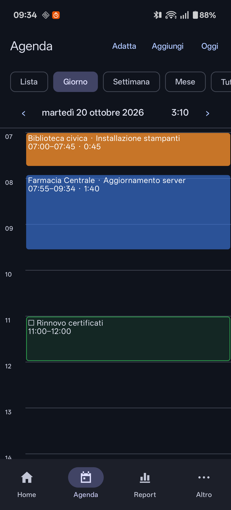
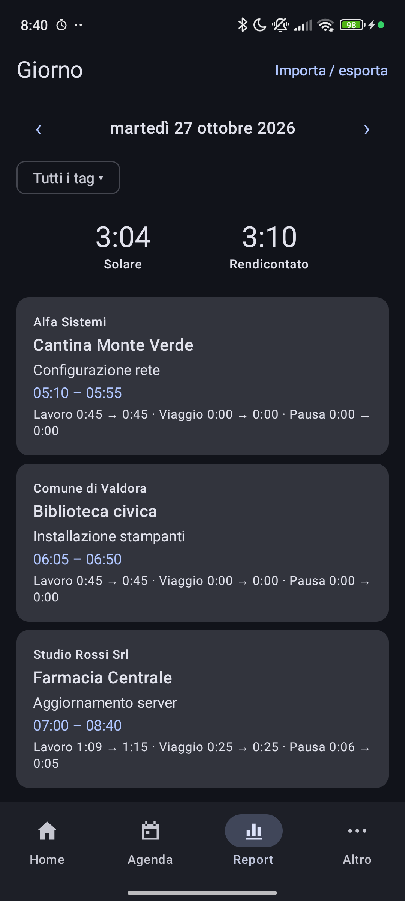
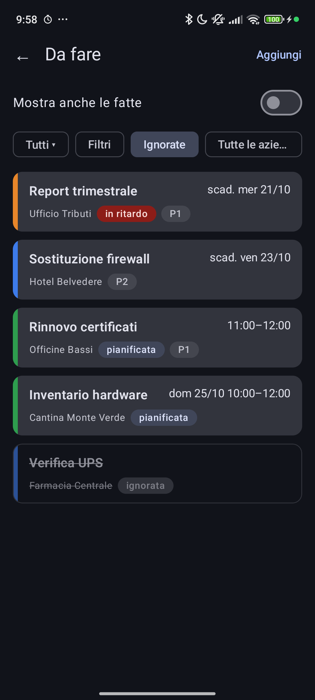
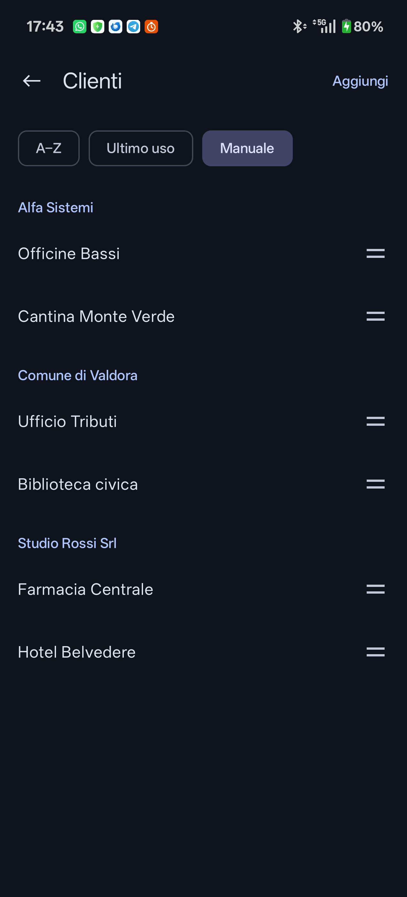
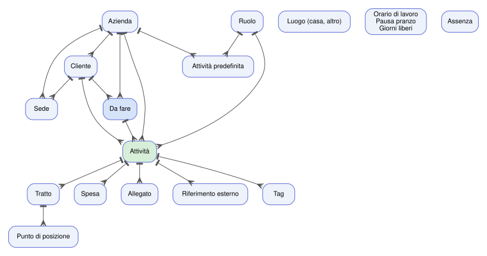
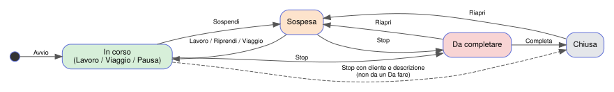
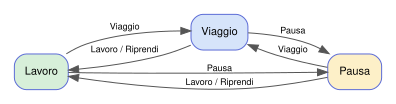
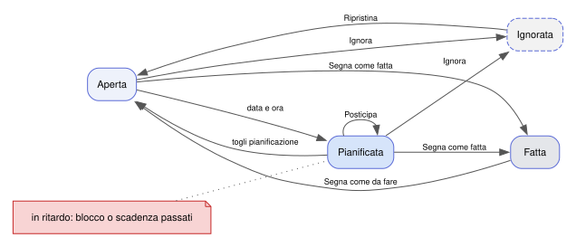
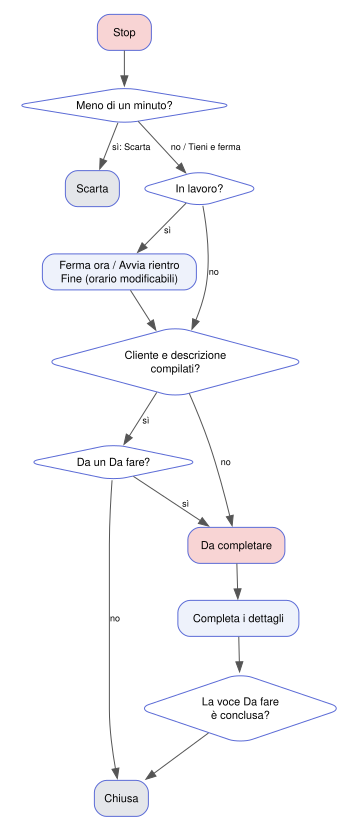

Versione 0.6.0 (ottobre 2026). Segnalare ogni differenza tra questo manuale
e l'app. La *Guida rapida* riassume in poche pagine l'uso quotidiano; questo
manuale descrive tutto: la **Parte I** l'uso, la **Parte II** il riferimento
(impostazioni, entità, stati, flussi).

**Novità della 0.6.0**
- ✕ nei campi di testo per svuotarli (§3).
- Riquadri della Home: banda col colore scelto per l'azienda, stato "Chiusa"
  neutro, orari nella forma "dalle–alle (durata)" (§3).
- Scheda attività: "+ Viaggio" e "+ Pausa" in alto; in visualizzazione
  compatta i dettagli facoltativi si richiudono (§6).
- Avvio con **Fine**: per registrare un'attività passata o indicare la fine
  prevista (§4).
- Allo Stop l'attività con cliente e descrizione è subito **chiusa** (§6).
- *Da fare*: filtri rapidi azienda, ignorate, periodo (24 h, 7 gg, 30 gg,
  tutti) e filtri avanzati (§8).
- Manuale e guida rapida anche in PDF, in italiano e in inglese.

I nomi tra virgolette sono le voci dell'interfaccia in italiano; con il
telefono in un'altra lingua l'app usa inglese, tedesco o spagnolo.

---

# Parte I — Uso

## 1. Concetti

**Attività** — un intervento per un cliente (o per un'azienda, in viaggio
senza cliente noto). Ha cliente, azienda, ruolo, descrizione, località,
note, riferimenti esterni (ticket, URL, codici), spese e allegati.

**Segmenti** — il tempo di un'attività è fatto di tratti:
- **Lavoro** (verde), **Viaggio** (blu), **Pausa** (giallo).
- Sono registrati al minuto esatto; arrotondamenti e attribuzione ai giorni
  si applicano solo nei report e nelle esportazioni.

**Stati di un'attività**

| Stato | Significato |
|---|---|
| In corso (lavoro / trasferta / pausa) | il tempo scorre |
| Sospesa (arancione) | interrotta, da riprendere più tardi |
| Da completare (rosso) | fermata, mancano i dettagli |
| Chiusa | completata |

Più attività possono essere in corso insieme (es. un viaggio e una telefonata
di lavoro per un altro cliente).

**Solare e rendicontato**
- *Solare*: il tempo di orologio coperto da lavoro o viaggio di qualsiasi
  attività (le sovrapposizioni contano una volta).
- *Rendicontato*: la somma di lavoro e viaggio arrotondati di tutte le attività.

**Regole del report** (modificabili in Impostazioni → "Rendicontazione")
- Lavoro: arrotondato al quarto d'ora per eccesso, con tolleranza di 5 minuti
  (es. 1 h 04 → 1 h; 1 h 05 → 1 h 15); un lavoro breve vale almeno 15 min.
- Viaggio: per eccesso a 5 minuti.
- Pausa: per difetto a 5 minuti, minimo 5.
- Notte: un'attività che finisce entro le 06:00 del giorno dopo resta sul
  giorno di inizio; oltre, viene divisa a mezzanotte.

---

## 2. Primo avvio

**Installazione** — l'app da usare si scarica dalle *Releases* del repository
GitHub (file `ActivityTrack-<versione>.apk`); le versioni successive si
installano sopra la precedente senza perdere i dati. Sul telefono può esserci
anche **ActivityTrackDbg**, la versione di prova installata dal PC: è un'app
separata, con dati e cartella propri (`ActivityTrackDbg`).

1. **Cartella dati** — l'app chiede una cartella (`ActivityTrack`)
   per allegati, backup ed esportazioni. I file restano anche se l'app viene
   disinstallata. Se la cartella viene spostata o rinominata l'app lo segnala
   ("L'accesso alla cartella dati è stato perso") e chiede di sceglierla di nuovo.
2. **Permessi** — notifiche e posizione vengono chiesti all'apertura. In
   Impostazioni → "Posizione":
   - "Accesso alla posizione" → **"Consenti sempre"**: serve perché il
     tracciamento riparta anche dopo un riavvio o da una notifica;
   - "Ottimizzazione batteria" → **"Consenti"**: su OxygenOS evita che il
     sistema interrompa il tracciamento.
3. **Anagrafiche minime** (scheda "Altro" → "Anagrafiche"): almeno un'azienda
   e un cliente. Utili anche "Orario di lavoro e pausa pranzo" (per l'avviso
   di inizio giornata e il riepilogo serale) e una sede per i clienti
   frequenti (proposta automatica del cliente).

---

## 3. La barra in basso

| Scheda | Contenuto |
|---|---|
| **Home** | riquadro dell'attività in corso (o ▶ Avvia / 🚗 Viaggio), riquadri piccoli delle altre, ultime completate, "Da fare · prossime 24 h" |
| **Agenda** | consultazione: lista, giorno, settimana, mese |
| **Report** | il report di un giorno: solare, rendicontato, righe per attività, esportazione |
| **Altro** | "Da fare", "Importa / esporta", "Anagrafiche", "Impostazioni" (con "Gesti") |

Da una scheda diversa dalla Home, il tasto Indietro torna alla Home.

### La Home a riquadri
- In alto il **riquadro grande**: l'attività aperta più recente, con tempo,
  stato e comandi. Senza attività aperte mostra "Nessuna attività in corso"
  con i pulsanti **▶ Avvia** (apre "Nuova attività") e **🚗 Viaggio** (il
  viaggio parte subito, la destinazione si indica dopo o arriva con
  l'arrivo); trascinandolo a sinistra si avvia, a destra parte il viaggio.
- Con attività aperte, ▶ e 🚗 sono nella barra in alto (🚗 apre "Nuova
  attività" con Viaggio già scelto, perché chiede cosa fare delle altre).
- Sotto, un **riquadro piccolo** per ogni altra attività aperta (in pausa,
  sospesa, da completare): stato e orari nella forma "dalle–alle (durata)"
  (es. "11:00–11:45 (0:45)"), e un pulsante per riprenderla (o metterla in
  pausa, o completarla). Toccandolo, l'attività passa nel
  riquadro grande.
- Restano visibili anche le **ultime attività completate** (2, o 3 in
  visualizzazione compatta), più tenui e con lo stato "Chiusa" in grigio:
  toccandole si apre la scheda. Le
  attività aperte in background prendono il loro posto.
- Sotto il separatore **"Da fare · prossime 24 h"** un riquadro per ogni voce
  pianificata o in scadenza nelle prossime 24 ore (comprese quelle in
  ritardo); in fondo, barrate, quelle ignorate oggi.

### Gesti (trascinare i riquadri)
Ogni riquadro si trascina a sinistra o a destra (Home, lista dell'Agenda,
schermata "Da fare"). Un trascinamento breve mostra i pulsanti, da toccare;
uno lungo esegue subito il primo.

| Riquadro | A sinistra | A destra |
|---|---|---|
| Attività in corso | Pausa, o Riprendi se è in pausa o sospesa | Termina (con le stesse domande del pulsante Stop) o Sospendi |
| Da fare | Avvia | Posticipa (se pianificata) o Ignora |
| Da fare ignorata | Ripristina | Ripristina |

Si cambiano in "Impostazioni" → **"Gesti"**: per ogni direzione cosa proporre
(anche nessuna azione), e se il trascinamento lungo esegue subito la prima.

### Colori di aziende e clienti
Nella scheda di un'azienda o di un cliente ("Altro" → "Anagrafiche") scegli
un **colore** fra dodici, o "Nessun colore". I riquadri delle attività e
delle voci da fare hanno una sottile **banda verticale** a sinistra con il
colore dell'azienda; quando la lista mostra una sola azienda, la banda ha il
colore del **cliente**. Senza un colore scelto non c'è banda; in Agenda i
blocchi di quelle aziende sono grigi.

Accanto a "Da fare · prossime 24 h" (e nella schermata "Da fare") il pulsante **"Tutte
le aziende"** filtra le voci da fare per azienda: il filtro resta finché non
lo togli con la ✕. Le attività in corso non vengono filtrate. Nella schermata
"Da fare" il filtro del periodo (**24 h**, **7 gg**, **30 gg**, **Tutti**)
mostra le voci pianificate o in scadenza entro quel tempo (quelle in ritardo
sempre), **"Ignorate"** mostra o nasconde le voci ignorate. **"Filtri"** apre
i filtri avanzati: cliente, priorità, stato (aperta, pianificata, in ritardo),
pianificata sì/no; "Azzera" li toglie.

### Visualizzazione compatta
Impostazioni → "Visualizzazione" → **Compatta**: testo un po' più piccolo,
riquadri e pulsanti più stretti, per vedere più attività e voci insieme.

### Nuova azienda o cliente al volo
In "Nuova attività" il **+** accanto ad Azienda, Cliente, Predefinita e
Ruolo crea il nuovo elemento senza uscire (nell'editor delle voci da fare,
Azienda e Cliente); il nuovo elemento risulta già scelto (la predefinita
riempie la descrizione).

### Campi obbligatori e facoltativi
Il bordo dei campi dice quanto contano: **rosso** se obbligatorio e ancora
vuoto, **verde** quando è compilato (azienda, cliente, attività o
predefinita, titolo della voce da fare, importo e descrizione della spesa);
**giallo** se importante ma non obbligatorio (ruolo, data e ora pianificate);
**blu** se accessorio (note, riferimenti, località, durata, scadenza,
priorità). Nei menu di aziende e clienti compare il loro colore. In "Nuova
attività" l'azienda è solo un filtro dei clienti: con "Tutte le aziende" il
bordo è neutro, diventa verde quando un'azienda è scelta o viene dal cliente.

### Date e orari
Le date si scelgono con il calendario di Android. Gli orari con una
**griglia a 5 minuti**: una riga per ora, 12 caselle per riga, 12 ore alla
volta (**▲ Prima** / **Dopo ▼** spostano la finestra di 3 ore).
- orario singolo: tocca una casella; **"Orario esatto"** apre l'orologio di
  Android per i minuti fuori dalla griglia (es. 09:37); OK senza toccare nulla
  lascia l'orario com'era;
- tratti (Modifica tratto, + Viaggio, + Pausa): toccando Inizio o Fine la
  griglia sceglie tutti e due: tocca la prima casella e trascina fino
  all'ultima, oppure tocca la prima e poi l'ultima (anche dopo aver spostato
  la finestra). In alto l'intervallo e la durata; le caselle **tratteggiate**
  sono occupate da altri tratti di quel giorno.
I campi facoltativi hanno la ✕ per svuotarli.

### Svuotare un campo
Nei campi in cui si scrive (descrizione, note, nomi, tag, riferimenti,
ricerca dell'Agenda…) compare una **✕** appena contengono del testo: la
tocchi e il campo si svuota. Nelle caselle cliente con ricerca la ✕ svuota
la ricerca e mostra di nuovo tutto l'elenco; il cliente scelto resta finché
non ne scegli un altro.

---

## 4. Avviare un'attività

In Home: **▶ Avvia** nel riquadro "Nessuna attività in corso" (o trascinalo a
sinistra), oppure **▶** nella barra in alto quando altre attività sono aperte.

Nella schermata "Nuova attività":
- **Lavoro / Viaggio** in alto: un viaggio può partire senza cliente.
- **Azienda** filtra i clienti; **Cliente** è una casella in cui scrivere per
  cercare (maiuscole e accenti non contano) oppure scegliere dall'elenco,
  nell'ordine scelto in Anagrafiche (all'inizio i più recenti in cima).
- Se ti trovi entro il raggio di una sede, cliente e azienda sono già proposti;
  altrimenti l'app propone l'azienda dell'ultima attività di oggi.
- **Descrizione** e **ruolo** vengono proposti dall'ultima attività sullo
  stesso cliente negli ultimi 30 giorni. Il microfono nel campo detta il testo.
- **Inizio** (con "Orari modificabili", attivo all'inizio): vuoto = adesso;
  toccandolo quando è vuoto si apre la griglia a intervallo, che imposta inizio
  e fine insieme; se è già compilato si apre il selettore dell'orario;
  un orario già passato fa partire l'attività da lì (un orario che oggi non è
  ancora arrivato vale per ieri).
- **Fine (facoltativa)**: toccandola, la griglia sceglie inizio e fine insieme.
  - Fine già passata (per registrare un'attività passata): l'app chiede
    **"L'attività è conclusa?"**. "Sì" la registra ferma a quell'ora, come con
    Stop, senza chiedere delle attività in corso; "No" la avvia aperta.
  - Fine nel futuro: è la **fine prevista**, scritta sul riquadro. A quell'ora
    arriva la notifica **"… finita?"**: "Sì, stop alle HH:MM" la ferma lì,
    "No, continua" (o nessuna risposta) la lascia andare.
- Il pulsante verde in basso avvia (blu con l'auto se è un viaggio).

**Se un'altra attività è già in corso**, l'app chiede cosa farne:
- in lavoro: chiudere, sospendere o lasciarla andare;
- in viaggio: "il viaggio è finito?" (sì = ferma, no = lascia, oppure sospendi);
- in pausa: chiudere o lasciarla.

**Altri modi per partire**
- dalla notifica dell'avviso di inizio giornata ("Avvia attività");
- da una voce **Da fare** (cliente, descrizione e riferimenti già compilati);
- dal **widget** 4×1 o dalle **scorciatoie** dell'icona (clienti recenti): si apre
  la schermata di avvio con il cliente già scelto.

---

## 5. Durante l'attività

### Comandi
Nella card della Home e nella notifica:

| Icona | Comando |
|---|---|
| ▶ verde | Lavoro / Riprendi |
| ⏸ giallo | Pausa |
| 🚗 blu | Viaggio |
| 🌙 arancione | Sospendi |
| ⏹ rosso | Stop |

La card mostra il tempo del tratto in corso in grande e lo stato in
un'etichetta colorata. "Stop" mentre lavori chiede **"Ferma ora"** oppure
**"Avvia rientro"** (il viaggio di ritorno fa parte della stessa attività).
Con **"Orari modificabili"** la domanda compare sempre, anche in viaggio, con
il campo **Fine**: vuoto = adesso, altrimenti l'attività si ferma (o il
rientro parte) a quell'ora; non può essere nel futuro né prima dell'inizio del
tratto in corso. Lo Stop dalla notifica, dal widget o dal riquadro ferma
sempre subito.

### Notifica fissa
Una notifica per attività in corso, con cronometro e comandi. Mentre la
posizione è attiva non si può eliminare con uno swipe; negli altri casi
ricompare quando riapri l'app.

### Promemoria
- **Conferma** ogni 30 minuti di lavoro o viaggio: "Ancora su …?" con
  "Sì", "Pausa" o "Stop alle hh:mm" (ferma all'ultima conferma, se te ne eri
  dimenticato). Se non rispondi l'attività continua.
- **Pausa** ogni 15 minuti ("Ancora in pausa?"), muto durante la pausa pranzo.
- **Riepilogo** a fine orario di lavoro: solare e rendicontato del giorno.

### Posizione (automatica)
- Un punto ogni 5 minuti, più uno quando il telefono si muove; mai esportati.
- **"Lontano da …?"** — durante il lavoro, se ti allontani più di 100 m:
  "Viaggio dalle hh:mm" (il viaggio parte dall'ora in cui sei partito),
  "Ignora", "Stop alle hh:mm".
- **"Arrivo?"** — durante un viaggio, dopo 15 minuti fermo entro 100 m:
  presso la sede di un cliente propone "Lavoro da … dalle hh:mm" (assegna quel
  cliente al viaggio se non ne aveva uno); a casa propone lo stop; altrimenti
  "Lavoro dalle hh:mm" o "Sono ancora in viaggio".
- I km del viaggio sono calcolati sulla strada (OSRM) e la località proposta
  dal servizio di indirizzi (Nominatim), quando la rete è disponibile.

Tocca i **pulsanti** delle notifiche, non il testo: il testo apre l'app e
chiude la notifica senza eseguire l'azione. Se i pulsanti non si vedono,
trascina la notifica verso il basso per espanderla.

### Spese
Nella schermata dell'attività, sezione "Spese" → "Aggiungi spesa": importo in
euro, descrizione, "Foto dello scontrino" facoltativa. Spesa veloce: pulsante
**€** del widget o scorciatoia **"Spesa"** dell'icona (va all'attività in corso
più recente).

### Allegati
Sezione "Allegati": "Foto" (fotocamera), "Nota vocale" (registra finché non
tocchi "Ferma e salva"), "File" (qualsiasi documento). Toccando un allegato:
"Apri" o "Elimina". I file stanno nella cartella dati, in
`attachments/<anno>/<attività>/`.

---

## 6. Fermare e completare

Se fermi dall'app un'attività durata **meno di un minuto** (senza allegati né
spese), l'app la considera un errore e chiede se **scartarla** o tenerla e
fermarla come sempre.

Dopo lo Stop, se cliente e descrizione sono già compilati l'attività è subito
**chiusa**; altrimenti è **da completare** (notifica persistente e card
rossa). Quelle partite da una voce *Da fare* passano sempre da "da
completare", per la domanda sulla voce.
Nella schermata dell'attività:
- controlla cliente, descrizione (dettabile), ruolo, località, luogo, note;
- "Tempi": i pulsanti colorati **Viaggio** e **Pausa** aggiungono tratti
  dimenticati (anche con i km; almeno un minuto). Con "Orari modificabili"
  acceso, toccando un tratto concluso si apre **"Modifica tratto"**: data, inizio, fine e, per i viaggi, i km;
  **"Elimina"** lo toglie (non il tratto in corso né l'unico rimasto). I
  valori inseriti sostituiscono quelli registrati;
- **Tag**: etichette libere (es. `#remoto`, `#urgente`); scrivine uno o più
  nel campo e tocca "+", oppure tocca un suggerimento tra quelli già usati;
  la ✕ su un tag lo toglie. Si aggiungono anche dopo la chiusura;
- allegati (**Foto**, **Nota vocale**, **File**) e **Spesa** hanno pulsanti
  colorati con icona;
- "Riferimenti esterni": ticket, URL o codici (riconosciuti automaticamente);
- **"Completa"** (verde).

Se manca la descrizione l'app chiede: **"Lascia vuoto"**, **"Copia l'ultima: …"**
(l'ultima descrizione sullo stesso cliente) o **"Torna a modificare"**.
Se l'attività era partita da una voce *Da fare*, chiede **"L'attività da fare è
conclusa?"** ("Sì" la segna come fatta, "No, ci tornerò" la lascia aperta).

"Riapri" riporta un'attività chiusa o da completare allo stato sospeso.

---

## 7. Consultare: Agenda e Report

### Agenda
In alto le modalità e il periodo ("‹ ›" per scorrere, "Oggi" per tornare a
oggi; a destra il totale rendicontato del periodo).
- **Lista** — il mese, giorno per giorno, con ricerca per cliente,
  descrizione o tag (`remoto` o `#remoto`); i tag compaiono dopo la
  descrizione; le voci *Da fare* pianificate o in scadenza compaiono con ☐.
- **Giorno** — linea del tempo: ogni attività è un blocco dall'inizio alla
  fine; attività contemporanee affiancate; le *Da fare* pianificate sono
  blocchi con il bordo colorato.
- **Settimana** — sette colonne da lunedì; toccando un giorno si apre la vista Giorno.
- In Giorno e Settimana la linea del tempo copre l'orario di lavoro e si apre
  sull'attività in corso (o sull'ora attuale); **"Adatta"** fa stare tutto
  l'orario di lavoro in uno schermo, **"Scorri"** torna alla scala normale.
- **Mese** — griglia con le ore rendicontate per giorno, un pallino per
  azienda e uno per le *Da fare*; toccando un giorno si apre la vista Giorno.

**Filtro per tag**: il chip "Tutti i tag ▾" accanto alle modalità (compare
quando nel periodo ci sono attività con tag) mostra solo le attività con quel
tag; le *Da fare* si nascondono e i totali contano solo ciò che si vede.

Ogni azienda ha il suo colore. Toccando un'attività si apre la sua scheda;
toccando una *Da fare* si aprono le sue azioni (avvia, posticipa, fatta,
ripianifica).

**Pianificare dall'agenda**: nelle viste Giorno e Settimana tocca uno spazio
libero: si apre una nuova *Da fare* pianificata a quell'ora (a passi di
mezz'ora). "Aggiungi" in alto fa lo stesso per il giorno mostrato (oggi: la
prossima mezz'ora; altri giorni: le 09:00).

### Report

Il report di un giorno: totale solare e rendicontato, una riga per attività
con lavoro, viaggio e pausa reali → arrotondati; da qui anche l'esportazione.
Con il filtro per tag restano le attività con quel tag: il rendicontato è la
loro somma, il "solare" la somma di lavoro e viaggio esatti. Anche
l'esportazione ha il campo **Tag** (solo le attività con quel tag; le altre
sezioni dell'interscambio non sono filtrate).

---

## 8. Da fare

Attività da fare, importate da un gestionale o create a mano ("Altro" →
"Da fare" → "Aggiungi", oppure dall'Agenda): titolo, cliente (o azienda),
**data e ora pianificate**, **durata**, scadenza e ora, priorità
(1 = massima), note, riferimenti (uno per riga).

Stati: **aperta** (senza pianificazione) → **pianificata** (data e ora) →
**fatta**. La pianificazione è separata dalla scadenza: ripianificare non
cambia la scadenza del gestionale.
- **Durata**: se la indichi, il blocco dura quella; se la lasci vuota dura
  un'ora e, finché la voce resta aperta, si allunga di ora in ora (fino a fine
  giornata).
- **Promemoria**: 15 minuti prima dell'ora pianificata arriva la notifica
  "Titolo alle HH:MM" con "Avvia attività", "Posticipa 30 min" (sposta la
  pianificazione di 30 minuti dall'ora pianificata o, se è già passata, da
  adesso; il promemoria torna prima della nuova ora) e "Ripianifica"
  (apre la voce). Arriva anche fuori orario e nei giorni liberi; sparisce se
  la voce viene avviata, segnata come fatta, ripianificata o se il blocco è
  passato.
- In Home, **"Da fare · prossime 24 h"** mostra quelle in scadenza o
  pianificate nelle prossime 24 ore, comprese quelle in ritardo; sono segnate "in ritardo" quelle ancora aperte dopo il loro blocco
  pianificato o dopo la scadenza (dopo l'ora di scadenza, o dal giorno dopo
  se la scadenza non ha ora).
- **Ignorare** una voce (gesto o azione "Ignora") invece di cancellarla: resta
  in fondo alla lista "Da fare", barrata, senza promemoria né evento in
  calendario; in Home compare solo il giorno in cui l'hai ignorata. Un altro
  trascinamento la ripristina. Un import dal gestionale non la ripristina.
- Toccando una voce: "Avvia attività", "Posticipa", "Segna come fatta" /
  "Segna come da fare", "Ripianifica" (o "Modifica" se non pianificata).
- Una voce può avere più attività (es. un lavoro su più giorni).

---

## 9. Inizio giornata, assenze, giorni liberi

- 15 minuti dopo l'inizio dell'orario di lavoro, se non hai avviato nulla,
  arriva **"Nessuna attività oggi"**: "Assente oggi", "Entrata in ritardo…"
  (chiede l'ora) o "Avvia attività".
- Non arriva nei **festivi nazionali** (Pasquetta compresa, 4 ottobre dal 2026)
  né nei **giorni liberi** ("Anagrafiche" → "Giorni liberi": data e nota, es. il
  santo patrono o le ferie).

---

## 10. Anagrafiche

- **Aziende** — nella scheda: sezione **"Gestionale"** (codice nel gestionale,
  connettore; per ora il generico, a file) e **"Calendario di questa azienda"**;
  sotto, le **sedi** dell'azienda.
- **Clienti** — appartengono a un'azienda (non si può cambiare dopo la prima
  attività); hanno le loro sedi.
- **Sedi** — etichetta, coordinate, raggio, indirizzo. Coordinate da
  "Posizione attuale" o da "Mappa" (sposta la mappa sotto il mirino e "Usa
  questo punto").
- **Ruoli**, **Attività predefinite** (testi ricorrenti, con ruolo proposto).
- **Ordine degli elenchi** — in cima ad Aziende, Clienti, Ruoli e Attività
  predefinite scegli **A–Z**, **Ultimo uso** (prima quelli usati più di
  recente; per le predefinite, l'ultima volta che le hai scelte) o
  **Manuale**: in manuale ogni riga ha la maniglia ≡ a destra; tienila e
  trascina la riga dove vuoi (i clienti si spostano dentro la loro azienda).
  Le nuove voci vanno in fondo. L'ordine scelto vale anche nei menu a tendina
  (es. "Nuova attività"); gli archiviati restano sempre in fondo.
  All'inizio: clienti per ultimo uso, il resto in ordine alfabetico.

- **Luoghi** — casa e altri luoghi (casa serve per l'arrivo a fine viaggio).
- **Orario di lavoro e pausa pranzo** — per giorno della settimana.
- **Giorni liberi**.

---

## 11. Importa / esporta, backup

"Altro" → "Importa / esporta".

**Esporta**
- **CSV**: una riga per attività e giorno, arrotondata; serve un periodo
  (massimo un anno).
- **JSON / XML** (formato generico, `docs/INTERCHANGE.md`): scegli il
  contenuto (anagrafiche, da fare, attività, assenze e giorni liberi), il
  periodo (vuoto = tutto), azienda e cliente; "Coordinate delle sedi" solo se
  servono.
- **Tag** (se ci sono attività con tag): solo le attività con quel tag, nel
  CSV e nell'interscambio (le anagrafiche e le altre sezioni restano intere).
- "Esporta" salva nella cartella `export`; "Esporta e condividi" apre anche
  il menu Condividi (email, Drive…).

**Importa** — un file JSON o XML generico (anche parziale, es. solo clienti o
solo *Da fare*). Il rapporto mostra cosa è stato aggiunto, cosa era già
presente, i **conflitti** (i dati dell'app restano invariati) e ciò che non è
stato importato con il motivo. Reimportare lo stesso file non crea doppioni.

**Backup** — ogni giorno l'app salva il database nella cartella `backup`
(ne conserva 14, modificabile); "Esegui backup ora" in Impostazioni.
**"Ripristina backup"** sostituisce tutti i dati con un backup scelto: prima
salva i dati attuali come backup `…-before-restore.zip`, poi riavvia l'app.

---

## 12. Calendario

Impostazioni → "Calendario":
1. consenti l'accesso al calendario;
2. "Calendario delle attività": un calendario del telefono (Google o CalDAV
   tramite DAVx5) oppure "Nuovo calendario ActivityTrack sul telefono";
3. un'azienda può avere il suo calendario (scheda azienda), che sostituisce
   quello generico.

Ogni attività diventa un evento per giorno, dall'avvio: titolo "Cliente –
Descrizione", nella descrizione i tempi arrotondati, km, riferimenti e note.
Le *Da fare* pianificate e aperte diventano eventi "provvisori" (Cliente –
Titolo) fino a un anno avanti; quando sono fatte escono dal calendario.
L'ultima riga della descrizione porta dei tag per tipo di tempo: `#lavoro`,
`#viaggio`, `#pausa`, `#pianificata`, sempre in italiano qualunque sia la
lingua del telefono (cercali nell'app calendario), seguiti dai tag
dell'attività.
Gli eventi sono **privati**: chi condivide il calendario (es. un calendario
Google condiviso con altri) vede solo "occupato", senza titolo né dettagli.
La sincronizzazione è solo dall'app al calendario: modifiche fatte nel
calendario vengono sovrascritte. Gli ultimi 14 giorni si aggiornano da soli;
"Sincronizza 90 giorni" riallinea più indietro.

---

## 13. Widget, riquadro, scorciatoie

- **Widget "Stato attività" (4×1)** — l'attività in corso con i comandi e "€";
  senza attività, i clienti recenti e il pulsante di avvio.
- **Widget "Pausa / riprendi" (1×1)** — mette in pausa o riprende l'attività
  più recente; senza attività apre l'avvio.
- **Riquadro delle Impostazioni rapide** — stessa funzione del widget 1×1. Su
  OxygenOS si aggiunge da Impostazioni → "Riquadro Impostazioni rapide" →
  "Aggiungi".
- **Scorciatoie** (pressione lunga sull'icona) — i 4 clienti più recenti e "Spesa".

---

## 14. Impostazioni

Le impostazioni sono divise in sezioni, ognuna con la sua pagina e il suo
"Salva"; in fondo all'elenco c'è **"Gesti"**. Il significato di ogni voce è
spiegato nella Parte II, §17.

| Sezione | Voce | Predefinito |
|---|---|---|
| Visualizzazione | Normale / Compatta | Normale |
| Orari | Orari modificabili liberamente: inizio e fine scelti all'avvio e allo stop, tratti modificabili ed eliminabili (spento: orari come registrati; "+ Viaggio" e "+ Pausa" restano) | acceso |
| Promemoria | Intervallo di conferma | 30 min |
| | Numero massimo di conferme | 0 (illimitato) |
| | Intervallo promemoria pausa | 15 min |
| | Ritardo avviso inizio giornata | 15 min |
| Notifiche | per ogni tipo (conferma, pausa, pianificate, spostamento, arrivo, inizio giornata, riepilogo, da completare, in corso) apre la pagina di Android per banner, suono e vibrazione | — |
| Posizione | accesso, batteria, riquadro rapido | — |
| | Soglia avviso spostamento | 100 m |
| | Raggio / tempo di arrivo | 100 m / 15 min |
| | Fattore distanza stradale (senza OSRM) | 1,25 |
| Calendario | calendario delle attività, sincronizza 90 giorni | nessuno |
| Dettatura | Lingua di dettatura | Italiano |
| Rendicontazione | attività notturne fino alle | 06:00 |
| | arrotondamenti lavoro / viaggio / pausa | §1 |
| Servizi online | Nominatim, OSRM, mappe OpenStreetMap (attivabili e con endpoint) | attivi |
| Archiviazione | cartella dati, backup conservati, backup ora | 14 |
| Avanzate | Promemoria attività pianificate (min prima) | 15 |
| | Posticipo (min) | 30 |

I valori fuori intervallo vengono corretti al salvataggio.

---

## 15. Dati e privacy

- Tutto resta sul telefono e nella cartella dati che hai scelto.
- Le **coordinate** dei tuoi spostamenti non vengono mai esportate né mandate
  al calendario; solo la località (es. "Milano").
- Gli eventi nel calendario sono privati: chi lo condivide vede solo "occupato".
- I servizi online (indirizzi, distanze, mappe) ricevono solo coordinate di
  singoli punti; si possono disattivare o puntare a server propri.
- Le credenziali dei gestionali sono cifrate con il keystore del telefono.

---

## 16. Problemi frequenti

| Problema | Soluzione |
|---|---|
| Il tracciamento si ferma | Impostazioni → Posizione: "Consenti sempre" e batteria "Senza restrizioni" |
| La notifica dell'attività è sparita | riapri l'app: ricompare |
| "L'accesso alla cartella dati è stato perso" | la cartella è stata spostata o rinominata: sceglila di nuovo |
| Dettatura: "lingua non disponibile" | Impostazioni → Dettatura: scegli la lingua; per l'uso offline scarica il pacchetto della lingua nelle impostazioni vocali del telefono |
| Il riquadro rapido non è nell'elenco | Impostazioni → "Riquadro Impostazioni rapide" → "Aggiungi" |
| Un'azione della notifica non fa nulla | tocca il pulsante, non il testo; espandi la notifica se i pulsanti non si vedono |
| Importazione: "Non importati" | il rapporto indica il motivo (es. azienda sconosciuta, attività in corso su un altro telefono) |

# Parte II — Riferimento

## 17. Impostazioni in dettaglio

Ogni sezione ha il suo "Salva". I valori fuori dall'intervallo ammesso vengono
riportati al limite più vicino.

### Visualizzazione

| Voce | Effetto | Predefinito |
|---|---|---|
| Normale / Compatta | Compatta: testo all'88 %, riquadri e pulsanti più stretti; nella scheda attività i dettagli facoltativi vuoti (località, dove, note) si richiudono in "Altri dettagli ▾". | Normale |

### Orari

| Voce | Effetto | Predefinito |
|---|---|---|
| Orari modificabili liberamente | Acceso: campi **Inizio** e **Fine** all'avvio, campo **Fine** nella domanda di Stop, tratti modificabili ed eliminabili (i nuovi valori sostituiscono quelli registrati). Spento: gli orari restano quelli registrati, i tratti non si toccano; "+ Viaggio" e "+ Pausa" restano disponibili. In futuro potrà essere imposta da una policy. | acceso |

### Promemoria

| Voce | Effetto | Intervallo | Predefinito |
|---|---|---|---|
| Intervallo di conferma | ogni quanti minuti di lavoro o viaggio arriva "Ancora su …?" | 10–240 min | 30 |
| Numero massimo di conferme | dopo quante conferme senza risposta l'app smette di chiedere (0 = mai) | 0–100 | 0 |
| Intervallo promemoria pausa | ogni quanti minuti di pausa arriva "Ancora in pausa?"; muto nella pausa pranzo | 10–120 min | 15 |
| Ritardo avviso inizio giornata | quanti minuti dopo l'inizio dell'orario arriva "Nessuna attività oggi" | 0–240 min | 15 |

### Notifiche
Per ogni tipo di notifica (conferma, pausa, pianificate, spostamento, arrivo,
inizio giornata, riepilogo, da completare, in corso) apre la pagina di Android
dove scegliere banner, suono e vibrazione.

### Posizione

| Voce | Effetto | Intervallo | Predefinito |
|---|---|---|---|
| Accesso alla posizione | serve "Consenti sempre" perché il tracciamento riparta da solo | — | — |
| Ottimizzazione batteria | "Senza restrizioni" evita che OxygenOS fermi il servizio | — | — |
| Riquadro Impostazioni rapide | aggiunge il riquadro Pausa / riprendi | — | — |
| Soglia avviso spostamento | distanza oltre la quale, in lavoro, arriva "Lontano da …?" | 50–5000 m | 100 |
| Raggio di arrivo | entro quanti metri si considera fermo | 25–1000 m | 100 |
| Tempo di arrivo | dopo quanti minuti fermo, in viaggio, arriva "Arrivo?" | 5–120 min | 15 |
| Fattore distanza stradale | km stradali = linea d'aria × fattore, quando OSRM non è disponibile | 1,0–3,0 | 1,25 |

### Calendario
Accesso al calendario, calendario delle attività (Google o CalDAV tramite
DAVx5, oppure "Nuovo calendario ActivityTrack sul telefono") e
"Sincronizza 90 giorni". Il calendario di un'azienda si sceglie nella sua
scheda e prevale su quello generico.

### Dettatura
Lingua del riconoscimento vocale (italiano, inglese, tedesco, spagnolo),
indipendente dalla lingua del telefono. Predefinito: italiano.

### Rendicontazione

| Voce | Effetto | Predefinito |
|---|---|---|
| Attività notturne fino alle | un'attività che finisce entro quest'ora del giorno dopo resta sul giorno di inizio (0:00–12:00) | 06:00 |
| Arrotondamento lavoro | modo, quanto (1, 5, 15, 30 o 60 min) e minimo | per eccesso con tolleranza, 15 min |
| Arrotondamento viaggio | idem | per eccesso, 5 min |
| Arrotondamento pausa | idem | per difetto, 5 min, minimo 5 |

Modi di arrotondamento:
- **per eccesso con tolleranza**: si arrotonda per eccesso solo oltre un terzo
  del quanto (15 min: fino a 5 minuti oltre il quarto d'ora si scende);
- **per eccesso**: al quanto successivo;
- **per difetto**: al quanto precedente.

### Servizi online
Nominatim (località dagli indirizzi), OSRM (km su strada) e mappe
OpenStreetMap: ognuno si accende o spegne e può puntare a un server proprio.
Predefinito: attivi, server pubblici.

### Archiviazione
Cartella dati, numero di backup giornalieri conservati (1–365, predefinito 14),
"Esegui backup ora".

### Avanzate

| Voce | Intervallo | Predefinito |
|---|---|---|
| Promemoria attività pianificate (minuti prima) | 0–240 | 15 |
| Posticipo (minuti) | 10–240 | 30 |

### Gesti
Per le attività e per i *Da fare*, cosa offre il trascinamento a sinistra e a
destra (anche nessuna azione) e se il trascinamento lungo esegue subito la
prima azione. Predefiniti: attività a sinistra Pausa / Riprendi, a destra Stop
o Sospendi; *Da fare* a sinistra Avvia, a destra Posticipa o Ignora;
trascinamento lungo attivo.

### Impostazioni ricordate dalle schermate
Il filtro azienda dei *Da fare*, il periodo (24 h, 7 gg, 30 gg, tutti),
"Ignorate" e l'ordine di ogni elenco delle anagrafiche si impostano nelle
schermate stesse e restano finché non li cambi.

## 18. Entità e relazioni

| Entità | Contenuto | Relazioni |
|---|---|---|
| Azienda | nome, colore, codice nel gestionale, connettore, calendario | ha clienti, sedi, *Da fare*, attività predefinite |
| Cliente | nome, colore, codice | appartiene a un'azienda (fissa dopo la prima attività); ha sedi |
| Sede | etichetta, coordinate, raggio, indirizzo | di un'azienda o di un cliente; serve a proporre cliente e azienda e a riconoscere l'arrivo |
| Ruolo | nome | proposto dalle attività predefinite, scelto sull'attività |
| Attività predefinita | testo, ruolo proposto, azienda (facoltativa) | riempie la descrizione |
| Attività | cliente, azienda, ruolo, descrizione, località, dove, note, stato, fine prevista | ha tratti, spese, allegati, riferimenti, tag; può nascere da un *Da fare* |
| Tratto | tipo (lavoro, viaggio, pausa), inizio, fine, km, origine (registrato o a mano) | di un'attività; i punti di posizione appartengono ai tratti |
| Spesa | importo, descrizione, scontrino | di un'attività |
| Allegato | foto, nota vocale, file | di un'attività, nella cartella dati |
| Riferimento esterno | ticket, URL, codice | di un'attività |
| Tag | parola libera | di un'attività |
| *Da fare* | titolo, cliente, pianificazione, durata, scadenza, priorità, note, riferimenti, stato | di un'azienda (e di un cliente); genera attività |
| Luogo | casa o altro, coordinate | casa chiude i viaggi di rientro |
| Orario di lavoro, pausa pranzo, giorni liberi, assenze | per giorno | regolano promemoria e riepiloghi |

## 19. Stati dell'attività

| Stato | Si entra con | Si esce con |
|---|---|---|
| In corso | avvio; Lavoro o Viaggio da sospesa | Sospendi, Stop, cambio di modalità |
| Sospesa | Sospendi (non dalla pausa); Riapri | Lavoro / Viaggio (riprende), Stop |
| Da completare | Stop (dettagli mancanti, o partita da un *Da fare*) | Completa, Riapri |
| Chiusa | Completa; Stop con cliente e descrizione | Riapri |

Mentre è in corso l'attività ha una **modalità**: ogni cambio chiude il tratto
aperto e ne apre uno nuovo.

Regole:
- un'attività non parte in pausa; dalla pausa non si sospende;
- più attività possono essere in corso insieme, ognuna con le sue pause;
- un'attività sotto il minuto, fermata dall'app, può essere scartata;
- un tratto aggiunto o modificato dura almeno un minuto, sta nel passato e non
  si sovrappone agli altri tratti della stessa attività.

## 20. Stati dei *Da fare*

Una voce è **in ritardo** quando il blocco pianificato è passato oppure quando
la scadenza è passata (dopo l'ora di scadenza, o dal giorno dopo se la
scadenza non ha ora). Una voce ignorata non riceve promemoria, non va nel
calendario e un import non la ripristina.

## 21. Flussi

### Avvio
1. Azienda e cliente proposti: dalla sede in cui ti trovi (entro il raggio),
   altrimenti l'azienda dell'ultima attività di oggi; un cliente scelto dal
   widget, da una scorciatoia o da un *Da fare* prevale.
2. Descrizione e ruolo: dall'ultima attività sullo stesso cliente negli ultimi
   30 giorni, finché non li modifichi.
3. Con "Orari modificabili": Inizio (vuoto = adesso) e Fine facoltativa. Fine
   già passata → "L'attività è conclusa?"; fine futura → fine prevista con
   notifica "… finita?" a quell'ora.
4. Le attività già in corso: per ognuna l'app chiede cosa farne (chiudi,
   sospendi, lascia; in viaggio "il viaggio è finito?"). Una attività passata
   registrata con Fine non chiede nulla.

### Stop e completamento

Lo Stop dalla notifica, dal widget o dal riquadro rapido ferma subito, senza
domande; gli stessi controlli (chiusa o da completare) valgono anche lì.

### Promemoria
Un solo allarme alla volta, puntato sul promemoria più vicino; i promemoria
"conferma" e "pausa" non scendono sotto i 10 minuti (Android limita gli
allarmi in Doze).

| Promemoria | Quando | Risposte |
|---|---|---|
| Conferma | ogni *intervallo di conferma* di lavoro o viaggio, anche fuori orario | Sì, Pausa, Stop alle (ultima conferma) |
| Pausa | ogni *intervallo pausa* in pausa; muto nella pausa pranzo | Riprendi, Stop |
| Fine prevista | all'ora di fine scelta all'avvio, una volta | Sì, stop alle HH:MM; No, continua |
| Inizio giornata | *ritardo* dopo l'inizio dell'orario, nei giorni lavorativi non liberi, se non hai fatto nulla | Assente oggi, Entrata in ritardo, Avvia |
| Riepilogo | a fine orario di lavoro | — |
| *Da fare* pianificata | *minuti prima* della pianificazione, anche fuori orario | Avvia, Posticipa, Ripianifica |

### Posizione
- Un punto ogni 5 minuti, più uno quando il telefono si muove, solo mentre
  un'attività è in corso (anche in pausa).
- In lavoro, oltre la *soglia di spostamento*: "Lontano da …?" con "Viaggio
  dalle HH:MM" (dal primo punto oltre la soglia).
- In viaggio, fermo entro il *raggio* per il *tempo di arrivo*: "Arrivo?";
  presso la sede di un cliente propone il lavoro per quel cliente, a casa lo
  stop.
- Km: OSRM se attivo, altrimenti linea d'aria × fattore; località da
  Nominatim. Le coordinate non escono mai dal telefono.

### Report ed esportazione
- *Solare*: il tempo coperto da lavoro o viaggio di qualsiasi attività
  (sovrapposizioni contate una volta); *rendicontato*: somma di lavoro e
  viaggio arrotondati.
- Un'attività che passa la mezzanotte va sul giorno di inizio se finisce
  entro le *attività notturne fino alle*, altrimenti si divide a mezzanotte.
- CSV: una riga per attività e giorno, con inizio, fine, ore di lavoro, pausa
  e viaggio arrotondate, azienda, cliente, ruolo, descrizione, km, spese,
  note, riferimenti, località, tag; km e spese sul primo giorno.

### Calendario
Un evento per attività e giorno, dall'avvio (un'attività in corso finisce
"adesso"). Ogni modifica risincronizza gli ultimi 14 giorni; "Sincronizza 90
giorni" va più indietro. Le *Da fare* pianificate aperte sono eventi
provvisori fino a un anno avanti. Tutti gli eventi sono privati. La
sincronizzazione va solo dall'app al calendario.

### Importazione ed esportazione
Il formato generico (JSON o XML) contiene anagrafiche, *Da fare*, attività
con tratti, spese, riferimenti e tag, assenze e giorni liberi. L'importazione
riconosce ciò che ha già (codici e identificativi), non crea doppioni e in
caso di conflitto tiene i dati dell'app, elencando il conflitto nel rapporto.
Le attività in corso su un altro telefono non vengono importate.

### Backup e ripristino
Ogni giorno una copia del database va nella cartella `backup` (zip). Il
ripristino salva prima i dati attuali come `…-before-restore.zip`, poi
sostituisce il database e riavvia l'app.
