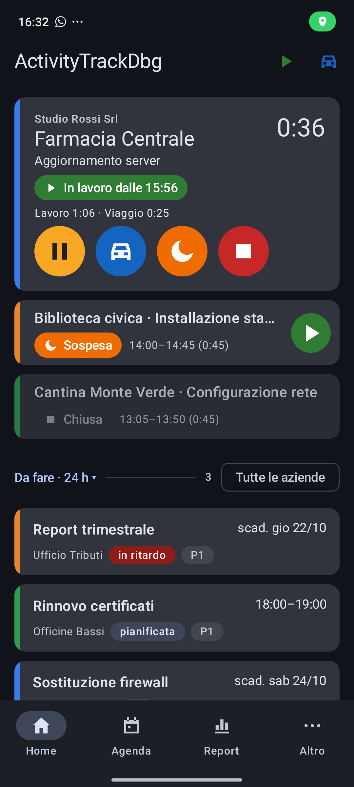
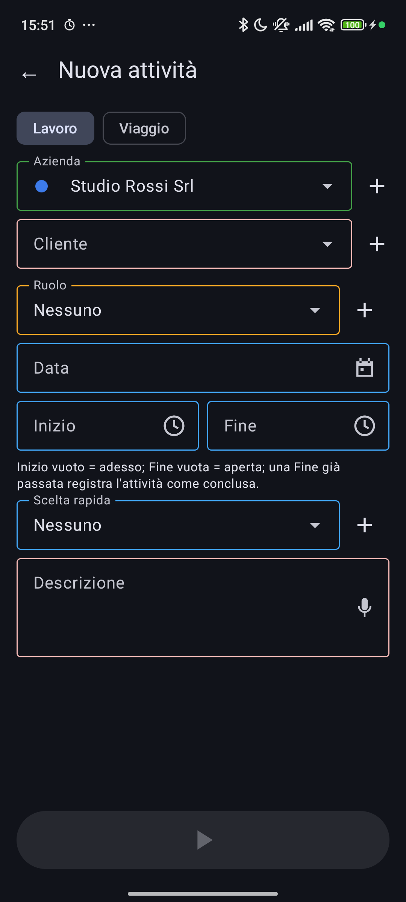
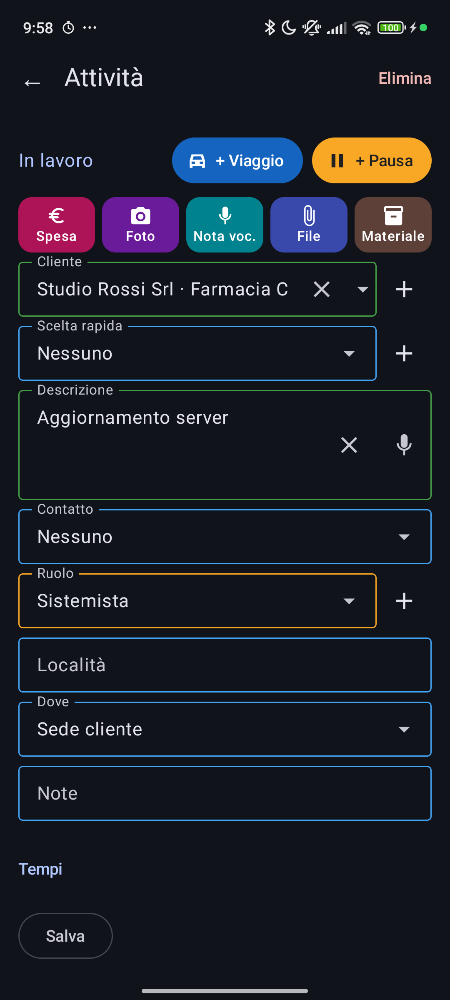
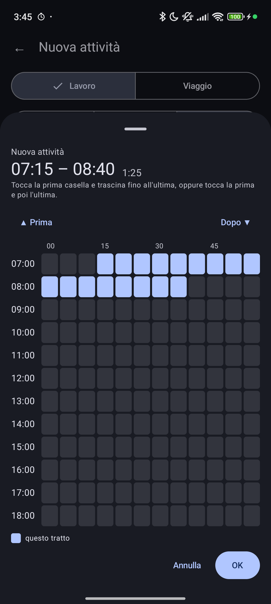

Versione 0.6.2 · per l'uso di tutti i giorni; il *Manuale* spiega tutto il
resto.

## 1. Prima volta
1. Installa `ActivityTrack-<versione>.apk` dalle *Releases* di GitHub.
2. Scegli la **cartella dati** (es. `ActivityTrack`): allegati, backup ed
   esportazioni vanno lì.
3. Concedi **notifiche** e **posizione** ("Consenti sempre"); in Impostazioni
   → Posizione togli le restrizioni della batteria.
4. "Altro" → "Anagrafiche": crea almeno un'**azienda** e un **cliente**;
   imposta l'**orario di lavoro**.

## 2. Avviare
In Home tocca **▶** (lavoro) o **🚗** (viaggio, parte subito).

In "Nuova attività" scegli il **cliente** (scrivi per cercare), la
**descrizione** (anche dettata col microfono) e il **ruolo**, poi il pulsante
verde. **Inizio** e **Fine** facoltativi servono per un'attività già
iniziata o per registrarne una passata.

## 3. Durante il lavoro
- I pulsanti del riquadro (e della notifica): **▶ Lavoro**, **⏸ Pausa**,
  **🚗 Viaggio**, **🌙 Sospendi**, **⏹ Stop**.
- Trascina il riquadro: a sinistra pausa / riprendi, a destra stop / sospendi.
- Ogni 30 minuti l'app chiede "Ancora su …?": rispondi dalla notifica.
- Se ti sposti, l'app propone il **viaggio**; quando arrivi, il **lavoro**.
- Con Impostazioni → **Chiamate** attivo, una telefonata con un contatto di
  un altro cliente mette in pausa l'attività e propone di registrarla.

## 4. Fermare
**⏹ Stop**: se cliente e descrizione ci sono, l'attività è **chiusa**;
altrimenti resta **da completare** (riquadro rosso): toccala, completa i
dettagli e "Completa". Nella scheda: "+ Viaggio" e "+ Pausa" in alto per
i tratti dimenticati, tag, spese, allegati.

## 5. Consultare
- **Agenda**: lista, giorno, settimana, mese; ricerca e filtro per tag.
- **Report**: solare e rendicontato del giorno, esportazione CSV.
- **Da fare**: voci da gestionale o create a mano, con promemoria.

## 6. Orari
Gli orari si scelgono sulla **griglia a 5 minuti**: tocca una casella, o
trascina per un intervallo; "Orario esatto" per i minuti fuori griglia.

## 7. Se qualcosa non va

| Problema | Soluzione |
|---|---|
| Il tracciamento si ferma | Posizione "Consenti sempre", batteria senza restrizioni |
| La notifica è sparita | riapri l'app |
| Un'azione della notifica non fa nulla | tocca il pulsante, non il testo |
